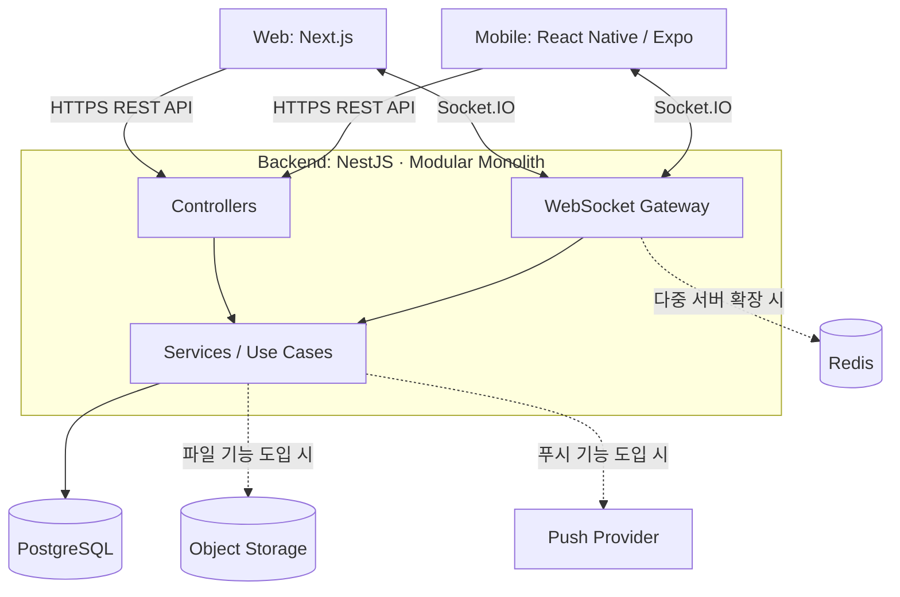
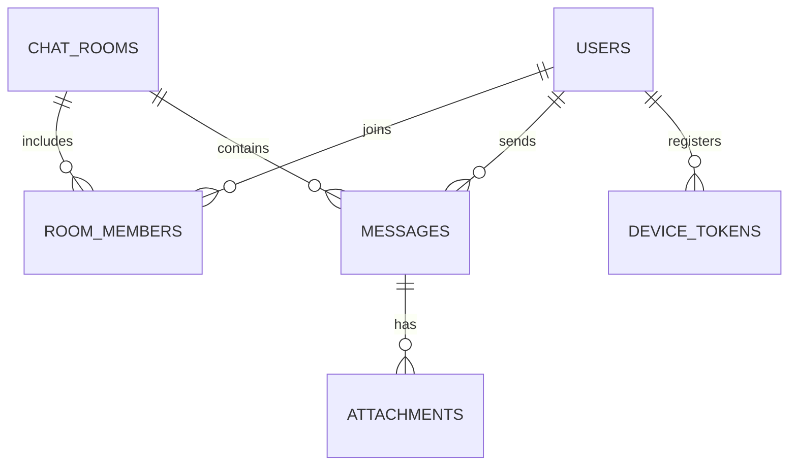

# 채팅 서비스 기술 스택 및 프론트엔드·백엔드 아키텍처

> **목표:** 하나의 백엔드를 통해 웹과 iOS/Android 앱에서 실시간 채팅 제공  
> **가정:** 사용자 간 1:1 및 그룹 채팅 서비스. AI 챗봇·라이브 스트리밍 채팅은 별도 요구사항에 따라 설계를 확장한다.  
> **권장 시작점:** **Modular Monolith + Layered Architecture + WebSocket 기반 이벤트 처리**  
> **설계 원칙:** MVP를 빠르게 출시하되, 인증·메시지 영구 저장·재연결·권한 검증은 초기부터 구현한다.

## 1. 핵심 기술 스택

### 1.1 권장 스택

| 영역 | 기술 | 목적 | 도입 시점 |
|---|---|---|---|
| 웹 | **Next.js + React + TypeScript** | 웹 UI, 라우팅, 서버 렌더링 | MVP |
| 모바일 | **React Native + Expo + TypeScript** | iOS/Android 앱 | MVP |
| 백엔드 | **NestJS + TypeScript** | REST API, 인증, 비즈니스 로직, WebSocket | MVP |
| 실시간 통신 | **Socket.IO (WebSocket 기반)** | 메시지 송수신, 채팅방 이벤트, 연결 관리 | MVP |
| 메인 DB | **PostgreSQL** | 사용자·채팅방·메시지 영구 저장 | MVP |
| ORM | **Prisma** | DB 스키마, 마이그레이션, 데이터 접근 | MVP |
| 프론트 서버 상태 | **TanStack Query** | API 캐시, 로딩·재시도·동기화 | MVP |
| 프론트 로컬 상태 | **Zustand** | 선택된 채팅방, UI 상태 등 | 필요 시 |
| 요청/이벤트 스키마 | **Zod + TypeScript 타입** | 입력 검증, 웹·앱·API 계약 공유 | MVP |
| 웹 스타일링 | **Tailwind CSS** | 웹 UI 스타일링 | MVP |
| 공통 코드 관리 | **pnpm workspace** | 웹·모바일·서버 간 타입·유틸리티 공유 | MVP |
| 캐시·서버 간 이벤트 | **Redis** | 접속 상태 관리, 수평 확장 시 Socket.IO 어댑터 등 | 확장 시 |
| 이미지·파일 | **S3 호환 Object Storage** | 첨부파일 저장 | 파일 첨부 시 |
| 앱 푸시 | **Expo Push / FCM / APNs** | 오프라인 사용자 알림 | 푸시 개발 시 |
| 모니터링 | **Sentry + 구조화된 서버 로그** | 오류·성능·운영 추적 | 출시 전 |
| 배포 | **Docker + 관리형 PostgreSQL + CI/CD** | 서버 배포 및 운영 | MVP |

**선택 이유:** 프론트엔드와 백엔드에 TypeScript를 공통 적용하고, NestJS의 모듈 구조로 기능별 책임을 나누면서 Socket.IO로 실시간 기능을 구현한다. 초기에는 API 서버를 단일 애플리케이션으로 배포한다.

### 1.2 지금 도입하지 않는 것

- **MSA / Kafka / Kubernetes:** 실제 트래픽, 장애 격리, 조직 규모가 요구하기 전까지는 보류한다.
- **Redis 필수화:** 단일 서버 MVP에서는 PostgreSQL을 우선 사용한다. 접속 상태를 프로세스 메모리에만 의존하는 경우 재시작·다중 서버에서 한계가 있으므로 운영 요건에 따라 Redis를 도입한다.
- **웹과 모바일의 UI 컴포넌트 전체 공유:** 플랫폼 렌더링 방식이 다르므로 공통 타입·검증 스키마·유틸리티를 우선 공유한다.

---

## 2. 전체 시스템 아키텍처



### 통신 역할 분리

| 방식 | 사용 목적 | 예시 |
|---|---|---|
| REST API | 조회·설정·계정 관리 | 로그인, 채팅방 목록, 이전 메시지 페이지 조회 |
| Socket.IO | 실시간 이벤트 | 메시지 전송·수신, 입력 중 표시, 읽음 상태 알림 |
| Push Notification | 앱이 백그라운드·오프라인일 때 알림 | 새 메시지 알림 |
| PostgreSQL | 시스템의 영구적인 정본(Source of Truth) | 메시지·참여자·읽음 위치 |

> **중요:** WebSocket 연결 또는 서버가 일시적으로 끊길 수 있으므로, 실시간 이벤트만으로 메시지 내역을 보장하지 않는다. 메시지를 DB에 저장하고 재접속 시 누락분을 조회하는 흐름이 필수다.

---

## 3. 프론트엔드 개발 구조

### 3.1 권장 패턴

**Feature-Based Architecture + 공통 UI 컴포넌트 설계**를 추천한다. Atomic Design의 원칙은 `ui/`에 적용하되, 프로젝트 전체를 Atoms/Molecules/Organisms로 강제하지 않는다.

| 구분 | 책임 | 예시 |
|---|---|---|
| `components/ui` | 도메인 비종속 기본 UI | Button, Input, Avatar, Dialog |
| `features` | 사용자 기능 단위 | auth, rooms, messages, profile |
| `widgets` | 여러 Feature를 조합한 큰 화면 영역 | ChatSidebar, ChatPanel |
| `app` / 라우트 | 페이지 라우팅·레이아웃 | 로그인 페이지, 채팅방 페이지 |
| `lib` | 인프라성 클라이언트 코드 | API client, Socket.IO client |
| `packages/contracts` | 웹·앱·API 공통 데이터 계약 | Message DTO, Socket 이벤트 스키마 |

### 3.2 웹: Next.js 폴더 구조 예시

```text
apps/web/
├── src/
│   ├── app/
│   │   ├── (auth)/login/page.tsx
│   │   ├── (main)/chats/page.tsx
│   │   ├── (main)/chats/[roomId]/page.tsx
│   │   └── layout.tsx
│   ├── components/
│   │   └── ui/                    # Button, Input, Avatar 등
│   ├── features/
│   │   ├── auth/
│   │   │   ├── api/
│   │   │   ├── components/
│   │   │   └── hooks/
│   │   ├── rooms/
│   │   │   ├── api/
│   │   │   ├── components/
│   │   │   └── hooks/
│   │   └── messages/
│   │       ├── api/
│   │       ├── components/         # MessageBubble, MessageComposer
│   │       ├── hooks/              # useMessages, useChatSocket
│   │       └── model/              # 메시지 UI 상태
│   ├── widgets/
│   │   ├── chat-sidebar/
│   │   └── chat-panel/
│   └── lib/
│       ├── api-client.ts
│       └── socket-client.ts
└── package.json
```

### 3.3 모바일: React Native + Expo 폴더 구조 예시

```text
apps/mobile/
├── app/                           # Expo Router
│   ├── (auth)/sign-in.tsx
│   ├── (tabs)/chats/index.tsx
│   └── chat/[roomId].tsx
├── src/
│   ├── components/ui/             # 모바일 전용 기본 UI
│   ├── features/
│   │   ├── auth/
│   │   ├── rooms/
│   │   └── messages/
│   ├── widgets/
│   └── lib/
│       ├── api-client.ts
│       ├── socket-client.ts
│       └── secure-storage.ts
└── package.json
```

### 3.4 프론트엔드 책임 분리 규칙

1. **API로 받은 서버 상태**는 TanStack Query를 중심으로 관리한다.
2. **임시 UI 상태**(모달, 선택 상태 등)만 컴포넌트 상태 또는 Zustand로 관리한다.
3. Socket.IO 이벤트를 받으면 해당 메시지를 안전하게 반영하거나 관련 API 캐시를 무효화한다.
4. 메시지 컴포넌트는 표시를 담당하고, API 호출·소켓 연결 코드는 hooks/service 계층으로 분리한다.
5. 웹/앱은 인증·API·이벤트 **계약을 공유**하되 UI는 플랫폼 특성에 맞게 구현한다.
6. 채팅방 이동·앱 백그라운드 전환·재접속 시 구독 및 연결 수명주기를 명확히 관리한다.

---

## 4. 백엔드 개발 구조

### 4.1 권장 패턴

**Feature-Based Modular Monolith + Layered Architecture**를 기본으로 한다.

- **Modular Monolith:** 인증, 사용자, 채팅방, 메시지, 알림 등을 모듈로 분리하되 하나의 서버 애플리케이션으로 운영한다.
- **Layered Architecture:** 각 모듈을 `Controller/Gateway → Service → Repository`로 구성한다.
- **Event-Driven:** 메시지 생성·읽음 처리 등의 결과를 실시간 이벤트로 전달한다. 이벤트 기반이라고 해서 처음부터 별도 메시지 브로커가 필요한 것은 아니다.

### 4.2 NestJS 폴더 구조 예시

```text
apps/api/
├── prisma/
│   ├── schema.prisma
│   └── migrations/
├── src/
│   ├── main.ts
│   ├── app.module.ts
│   ├── modules/
│   │   ├── auth/
│   │   │   ├── auth.module.ts
│   │   │   ├── auth.controller.ts
│   │   │   ├── auth.service.ts
│   │   │   └── dto/
│   │   ├── users/
│   │   ├── rooms/
│   │   │   ├── rooms.module.ts
│   │   │   ├── rooms.controller.ts
│   │   │   ├── rooms.service.ts
│   │   │   ├── rooms.repository.ts
│   │   │   └── dto/
│   │   ├── messages/
│   │   │   ├── messages.module.ts
│   │   │   ├── messages.controller.ts  # 과거 메시지 조회
│   │   │   ├── messages.gateway.ts     # 실시간 전송/수신
│   │   │   ├── messages.service.ts     # 권한 검증·저장·이벤트
│   │   │   ├── messages.repository.ts  # DB 접근
│   │   │   └── dto/
│   │   ├── presence/                 # 접속/활동 상태
│   │   ├── notifications/            # 푸시 알림
│   │   └── attachments/              # 파일 업로드
│   ├── common/
│   │   ├── guards/                   # 인증/인가
│   │   ├── filters/                  # 예외 응답
│   │   ├── interceptors/
│   │   └── pipes/                    # 입력 검증
│   ├── infra/
│   │   └── database/prisma.service.ts
│   └── config/
└── package.json
```

### 4.3 백엔드 계층별 책임

| 계층 | 역할 | 하지 말아야 할 일 |
|---|---|---|
| Controller | HTTP 요청 수신·입력 검증·응답 매핑 | 복잡한 비즈니스 규칙 작성 |
| Gateway | 소켓 연결 인증·이벤트 수신·방 구독·실시간 전달 | DB 쿼리 로직 직접 구현 |
| Service | 채팅방 참여 검증, 메시지 저장, 트랜잭션, 기능 규칙 | HTTP/Socket 전용 표현에 강하게 결합 |
| Repository | Prisma를 활용한 DB 조회·저장 | 인증 정책 등 비즈니스 의사결정 |
| DTO / Contract | 요청·응답·이벤트 구조와 검증 | 기능 수행 및 저장 |
| Infra | DB 연결, 외부 스토리지, 푸시 클라이언트 | 비즈니스 정책 소유 |

> API DTO·소켓 이벤트는 공유 타입만 믿지 말고 **서버 런타임에서 검증**한다. NestJS의 검증 파이프를 이용해 Zod 스키마를 연결하거나, Nest 기본 DTO 검증 전략 중 하나로 통일한다.

---

## 5. 권장 Monorepo 구조

```text
chat-platform/
├── apps/
│   ├── web/                        # Next.js
│   ├── mobile/                     # React Native + Expo
│   └── api/                        # NestJS
├── packages/
│   ├── contracts/                  # API DTO, Socket 이벤트 타입/스키마
│   ├── utils/                      # 플랫폼 비종속 유틸리티
│   └── config/                     # ESLint / TypeScript 공통 설정
├── infra/                          # Docker 및 배포 설정
├── pnpm-workspace.yaml
├── package.json
└── README.md
```

**공유 우선순위:** `contracts` → `utils` → 공통 설정. 플랫폼 간 UI 컴포넌트 공유는 실제로 유지보수 이점이 확인될 때 검토한다.

---

## 6. 주요 DB 데이터 모델

### 6.1 핵심 테이블

| 테이블 | 주요 필드 | 목적 |
|---|---|---|
| `users` | `id`, `email`, `display_name`, `avatar_url`, `created_at` | 사용자 계정 및 프로필 |
| `chat_rooms` | `id`, `type`, `name`, `created_at` | 1:1 / 그룹 채팅방 |
| `room_members` | `room_id`, `user_id`, `role`, `last_read_seq`, `joined_at` | 방 참여·권한·읽음 위치 |
| `messages` | `id`, `room_id`, `sender_id`, `client_message_id`, `seq`, `body`, `created_at` | 메시지 영구 보관 |
| `device_tokens` | `id`, `user_id`, `platform`, `push_token` | 모바일 푸시 알림 (선택) |
| `attachments` | `id`, `message_id`, `object_key`, `mime_type`, `size` | 이미지·파일 (선택) |

### 6.2 핵심 제약 및 인덱스

- `room_members (room_id, user_id)`: 고유 제약으로 중복 참여 방지.
- `messages (room_id, seq)`: 고유 제약과 조회 인덱스로 방 내부 정렬·커서 조회 지원.
- `messages (room_id, sender_id, client_message_id)`: 고유 제약으로 메시지 재전송 시 중복 저장 방지.
- `seq`는 **서버에서 채팅방 단위로 증가하는 값**이다. 동시 전송 시 충돌하지 않도록 트랜잭션으로 할당해야 한다.
- `last_read_seq`는 해당 방에서 사용자가 읽은 마지막 메시지 위치를 표현한다.
- 1:1 방 중복 생성 방지는 참여자 쌍을 식별하는 별도 제약 또는 생성 서비스의 트랜잭션 정책으로 해결한다.

### 6.3 간단한 관계도



---

## 7. 실시간 채팅 메시지 처리

### 7.1 메시지 전송 흐름

1. 클라이언트가 `clientMessageId`(UUID 등)를 생성하고 `message:send` 이벤트를 보낸다.
2. NestJS Gateway가 로그인 세션/토큰을 검증하고 Service를 호출한다.
3. Service가 **해당 사용자가 채팅방에 참여 중인지** 확인한다.
4. 트랜잭션에서 `seq`를 할당하고 메시지를 PostgreSQL에 저장한다. 같은 `clientMessageId`로 재요청했다면 기존 메시지를 반환한다.
5. 발신자에게 Socket.IO **ack**으로 저장 결과(`messageId`, `seq`)를 응답한다.
6. 서버가 해당 채팅방에 `message:new` 이벤트를 방송한다.
7. 미접속 사용자에게 필요한 경우 푸시 알림을 보낸다. 푸시 실패가 메시지 저장 성공을 취소하지는 않는다.
8. 재접속한 클라이언트는 마지막으로 확인한 `seq` 이후의 메시지를 REST API로 동기화한다.

### 7.2 Socket.IO 이벤트 계약 예시

| 방향 | 이벤트 | 주요 데이터 | 용도 |
|---|---|---|---|
| Client → Server | `room:join` | `roomId` | 권한 확인 후 방 이벤트 구독 |
| Client → Server | `room:leave` | `roomId` | 방 구독 종료 |
| Client → Server | `message:send` | `roomId`, `clientMessageId`, `body` | 메시지 전송; ack 응답 |
| Server → Client | `message:new` | `roomId`, `messageId`, `seq`, `senderId`, `body`, `createdAt` | 새 메시지 알림 |
| Client → Server | `message:read` | `roomId`, `lastReadSeq` | 읽음 위치 갱신 |
| Server → Client | `message:read-updated` | `roomId`, `userId`, `lastReadSeq` | 읽음 상태 동기화 |
| Client → Server | `typing:start` / `typing:stop` | `roomId` | 입력 중 상태 (선택) |

**전송 안정성 규칙**

- **저장 완료 후 ack**을 기본으로 하며, ack은 *DB 저장 성공*을 뜻하지 상대방의 수신·읽음을 뜻하지 않는다.
- 네트워크 재시도로 같은 메시지가 여러 번 올 수 있으므로 `clientMessageId` 기반 **멱등성**을 보장한다.
- 클라이언트는 `pending → sent → failed`와 같은 로컬 상태를 표시하고 실패 시 같은 ID로 재시도한다.
- `message:new` 중복 수신 시 `messageId`로 중복 렌더링을 방지한다.
- 재접속 후 마지막 `seq` 이후 메시지를 조회한다. Socket.IO만으로 정확히 한 번 전달(exactly-once)을 보장한다고 가정하지 않는다.
- 소켓 이벤트마다 인증·인가를 적용하고, `room:join` 요청만으로 방 접근을 허용하지 않는다.

---

## 8. REST API 설계 예시

| Method | Endpoint | 기능 |
|---|---|---|
| `POST` | `/api/v1/auth/sign-up` | 회원가입 |
| `POST` | `/api/v1/auth/login` | 로그인 |
| `POST` | `/api/v1/auth/refresh` | 인증 갱신 |
| `POST` | `/api/v1/auth/logout` | 로그아웃 |
| `GET` | `/api/v1/users/me` | 내 프로필 조회 |
| `GET` | `/api/v1/rooms` | 참여 중인 채팅방 목록 |
| `POST` | `/api/v1/rooms` | 1:1 / 그룹 채팅방 생성 |
| `GET` | `/api/v1/rooms/:roomId` | 채팅방 상세 조회 |
| `GET` | `/api/v1/rooms/:roomId/messages?beforeSeq=100&limit=30` | 이전 메시지 페이지 조회 |
| `GET` | `/api/v1/rooms/:roomId/messages?afterSeq=100&limit=100` | 재접속 누락분 동기화 |
| `POST` | `/api/v1/attachments/presign` | 첨부파일 업로드 URL 발급 (선택) |

실제 API 경로·데이터 구조·에러 코드는 `packages/contracts`에 정의하고, OpenAPI(Swagger) 문서도 함께 제공하는 것을 권장한다.

---

## 9. 인증·보안·운영 필수사항

### 인증 및 접근 제어

- 웹: HTTPS 기반 **HttpOnly·Secure 쿠키** 사용을 우선 고려하고 CSRF 방어 정책을 함께 설계한다.
- 모바일: 인증 정보를 OS **보안 저장소**에 보관한다(일반 AsyncStorage에 장기 토큰 보관 지양).
- WebSocket 연결 시에도 인증하고, 메시지 전송·조회·방 구독마다 **채팅방 멤버십**을 검증한다.
- 채팅방 초대·퇴장·차단·신고 정책은 초기 범위에 맞춰 정의한다.

### 입력·데이터·운영

- 요청 본문과 WebSocket 페이로드를 검증하고 메시지 크기 및 요청 빈도를 제한한다.
- 텍스트 렌더링 시 XSS를 방지한다. 파일 첨부에는 MIME/크기 제한, 접근 제어, 보안 검사를 적용한다.
- 로그와 오류 수집 시스템에 **메시지 본문, 비밀번호, 액세스 토큰**을 무분별하게 남기지 않는다.
- PostgreSQL 백업·복구, 비밀키 관리, 메시지 보존·탈퇴 시 삭제 정책을 정한다.
- 운영 지표: WebSocket 동시 연결 수, 메시지 저장 지연, ack 실패율, 재접속 빈도, DB 부하.

### 권장 테스트

| 대상 | 테스트 |
|---|---|
| Service | 메시지 저장, 멤버십 권한 검증, 읽음 위치 갱신 |
| API | 인증 실패, 권한 없는 채팅방 조회, 페이지네이션 |
| WebSocket | 중복 전송, 동시 전송, 재접속 및 누락 메시지 복구 |
| 웹 E2E | 로그인 → 방 입장 → 메시지 전송·수신 |
| 모바일 | 백그라운드·재실행·네트워크 변경 시 복구 |

---

## 10. 단계별 개발 범위

| 단계 | 프론트엔드 | 백엔드 / 데이터 | 완료 기준 |
|---|---|---|---|
| **1. 기반** | 웹·앱 프로젝트, 라우팅, 공통 UI | NestJS 초기화, PostgreSQL/Prisma, 인증 | 웹·앱 로그인 가능 |
| **2. 채팅 MVP** | 채팅방 목록, 메시지 목록·입력창 | Rooms/Messages, Socket.IO, 영구 저장 | 1:1 메시지 송수신·내역 조회 |
| **3. 안정화** | 전송 상태, 재전송, 재접속 UX | 멱등성, 커서 조회, 권한·동시성 테스트 | 메시지 중복·누락 복구 검증 |
| **4. 확장 기능** | 그룹 채팅, 읽음/입력 중, 알림 화면 | 읽음 이벤트, Presence, Push | 선택 기능 동작 |
| **5. 운영 확장** | 성능 개선, 에러 추적 | Redis, 서버 수평 확장, 모니터링 | 부하 테스트 결과에 맞춰 확장 |

**최소 MVP 권장 범위:** 가입·로그인, 프로필, 1:1 채팅방, 채팅방 목록, 메시지 전송·수신, 과거 내역 조회, 중복 방지, 재접속 동기화, 접근 권한 검증.

---

## 11. 개발 업무 분해(WBS) 단위

| 프론트엔드 작업 단위 | 산출물 예시 | 백엔드 작업 단위 | 산출물 예시 |
|---|---|---|---|
| Common UI | Button, Input, Avatar | 공통/인프라 | 예외 필터, 인증 가드, DB 연결 |
| Feature | 로그인 폼, 메시지 입력 | Domain Module | Auth, Rooms, Messages |
| Widget / Section | 채팅방 사이드바, 대화 패널 | HTTP API | 로그인, 방 목록, 메시지 조회 |
| Page / Route | 로그인·채팅 페이지 | WebSocket Event | 메시지 송수신, 읽음 이벤트 |
| 상태·통신 | API hooks, socket hooks | 데이터 모델 | Prisma schema, migration, index |
| 테스트·배포 | 웹/앱 E2E 및 빌드 | 테스트·운영 | 통합 테스트, 로깅, 배포 |

**작업 카드 예시 — 메시지 전송 기능**

- 프론트: MessageComposer 구현 → `message:send` 연결 → 전송 중/성공/실패 및 재시도 표시.
- 백엔드: `messages.gateway` → 사용자·방 권한 검증 → 메시지 저장·중복 방지 → ack/방송.
- DB: `messages` 테이블·인덱스·중복 방지 제약.
- 테스트: 비회원·비참여자 거부, 중복 요청, 동시 전송, 재연결 검증.

---

## 12. 초기 설계에서 확정할 항목

아래 항목은 현재 **미확정 요구사항**이며 기능 개발 전에 정하면 좋다.

1. **채팅 유형:** 1:1만 / 그룹 / 오픈채팅 / 익명채팅 중 어디까지 제공할지.
2. **사용자 가입:** 이메일, 소셜 로그인, 휴대폰 번호 중 지원 방식.
3. **메시지 정책:** 수정·삭제·신고·차단·보존 기간 및 검색 지원 여부.
4. **첨부파일:** 이미지·동영상·파일 지원 범위와 용량 제한.
5. **알림 및 읽음:** 읽음 표시 방식, 모바일 푸시, 접속 상태 노출 정책.
6. **성능 목표:** 목표 동시 접속 수, 메시지 처리량, 메시지 보관 기간.
7. **운영 환경:** 클라우드, 개인정보 저장 지역, 백업·장애 복구 목표.

---

## 최종 권장안

```text
웹             Next.js + TypeScript
모바일         React Native + Expo + TypeScript
백엔드         NestJS (Modular Monolith + Layered Architecture)
실시간         Socket.IO
DB             PostgreSQL + Prisma
서버 상태      TanStack Query
공통 계약      pnpm workspace + TypeScript/Zod
초기 배포      단일 NestJS 서버 + 관리형 PostgreSQL
확장 시        Redis / Object Storage / Push / 다중 서버
```

**한 줄 결론:** 채팅 서비스는 처음부터 마이크로서비스로 쪼개기보다, **기능별 NestJS 모듈을 가진 단일 백엔드와 Next.js·Expo 프론트엔드**로 시작하고, 메시지 저장·중복 방지·재접속 동기화·권한 검증을 초기 품질 기준으로 삼는다.
