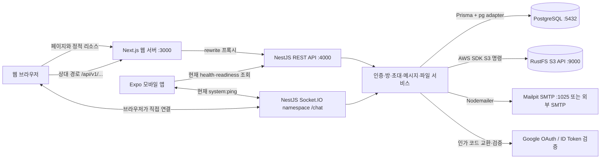
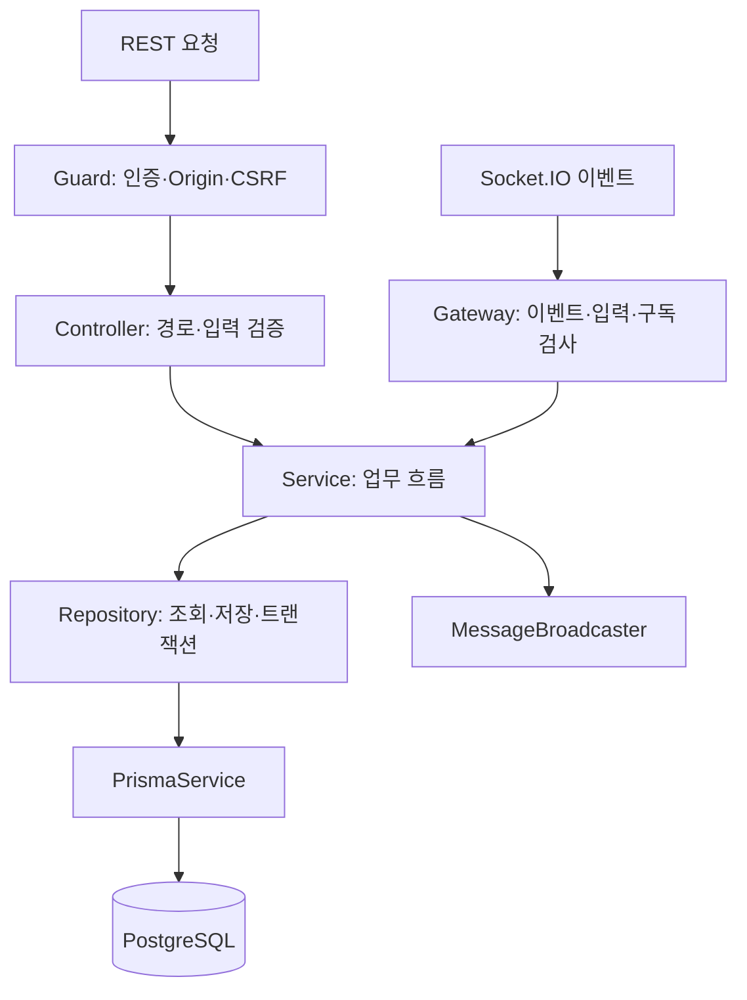
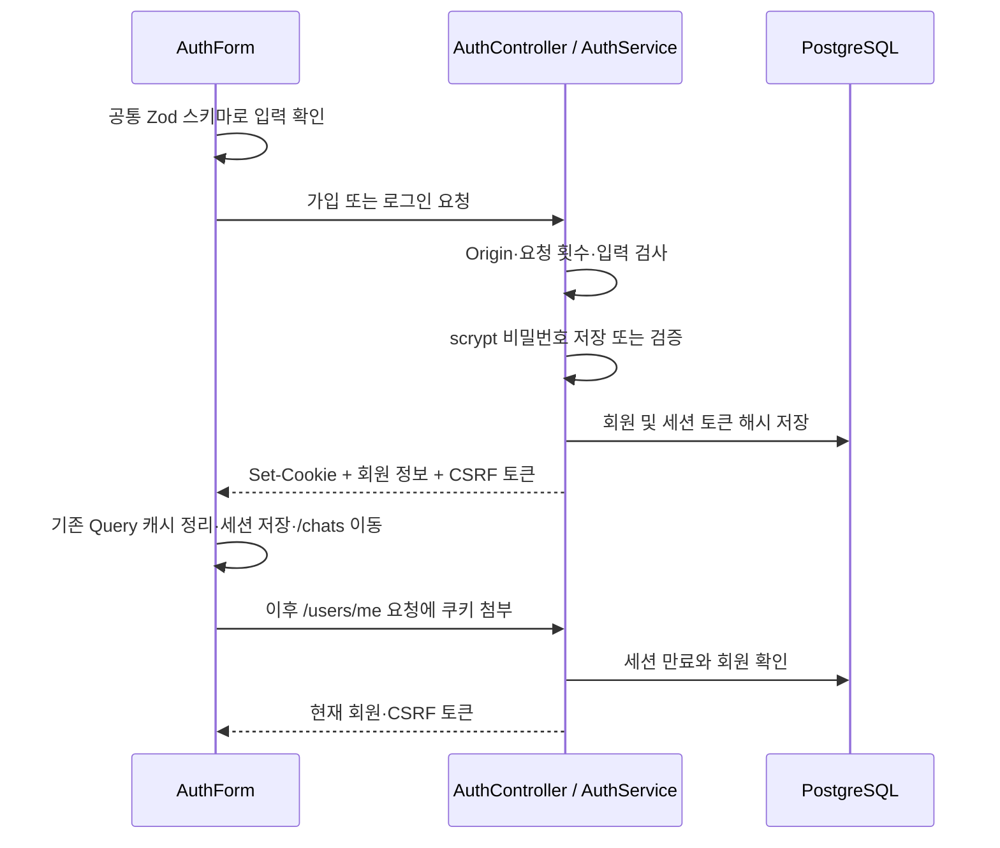
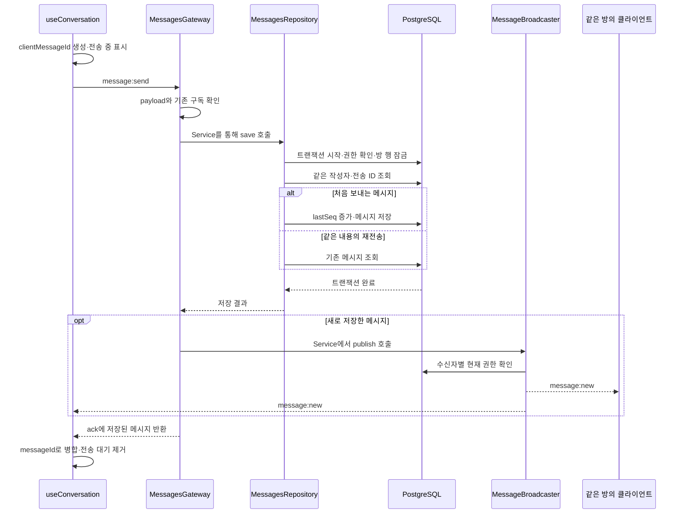
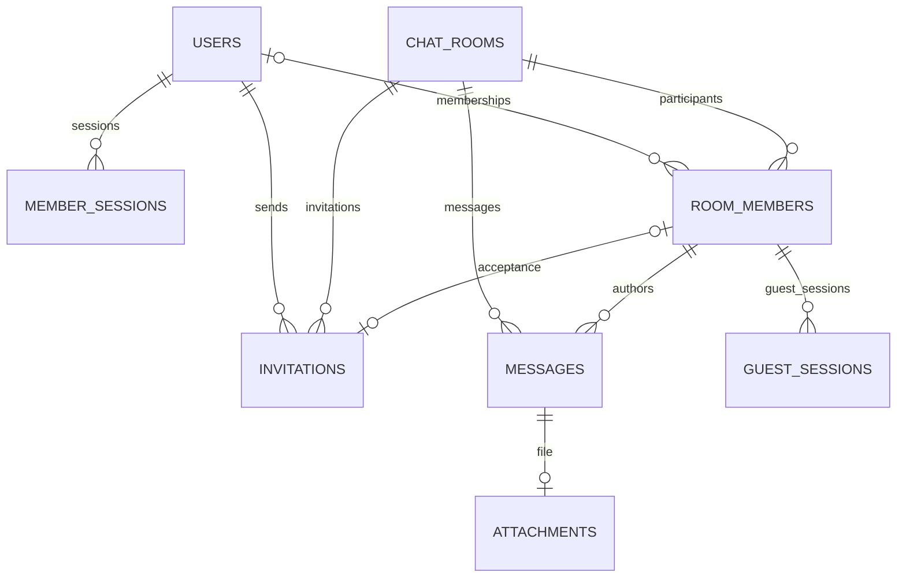

# 프로젝트 구조와 기술 사용 상세 설명

> 작성 기준: 2026-11-02의 저장소 소스·설정·SQL 마이그레이션.
>
> 이 문서는 **현재 구현된 코드**를 설명한다. 기술 버전은 각 `package.json`의 선언 범위 또는 Docker 이미지 태그 기준이며, 실행 중인 프로세스·운영 배포 상태를 의미하지 않는다. 문서 작성 과정에서 터미널 명령, 빌드, 테스트, 포매터는 실행하지 않았다. 실제 `.env`의 비밀값 대신 `.env.example`과 환경변수 검증 코드를 참고했다.
>
> [기존 아키텍처 문서](architecture.md)는 초기 설계와 향후 확장 방향을 포함한다. 실제 구현을 이해할 때는 이 문서를 먼저 읽고, 실행 절차는 [로컬 개발 안내](local-development.md), 초대 정책은 [초대 흐름 문서](invitation-flow.md)를 함께 참고하면 된다.

## 목차

1. [프로젝트 개요](#overview)
2. [전체 구조와 통신 경로](#architecture)
3. [폴더별 책임과 모노레포](#repository)
4. [사용 기술과 버전](#stack)
5. [공유 코드: TypeScript·Zod·계약](#contracts)
6. [웹 프론트엔드](#web)
7. [모바일 프론트엔드](#mobile)
8. [NestJS 백엔드](#backend)
9. [회원 인증과 구글 로그인](#authentication)
10. [이메일 초대와 게스트](#invitations)
11. [실시간 메시지·읽음·검색](#messages)
12. [첨부파일과 오브젝트 스토리지](#attachments)
13. [데이터베이스 구조와 무결성](#database)
14. [인프라·Docker·배포 경계](#infrastructure)
15. [REST API와 Socket.IO 이벤트](#interfaces)
16. [환경변수·빌드·테스트·CI](#development)
17. [구현 범위와 코드 읽는 순서](#status)

<a id="overview"></a>

## 1. 프로젝트 개요

이 프로젝트는 **회원이 채팅방을 만들고, 이메일 초대를 받은 사람이 회원가입 없이 해당 방의 게스트로 참여하는 채팅 서비스**다. 웹과 모바일이 하나의 NestJS API와 공통 데이터 계약을 사용하도록 구성되어 있다.

핵심 사용 흐름은 다음과 같다.

1. 회원이 이메일·비밀번호 또는 구글 계정으로 로그인한다.
2. 회원이 방 이름을 입력하면 그룹 채팅방이 생성되고, 생성자는 방장이 된다.
3. 방장이 이메일 초대를 발급한다.
4. 초대받은 사람은 링크에서 표시 이름을 입력하고 게스트로 입장한다.
5. 회원과 게스트가 메시지·파일을 주고받고, 읽음 상태·이전 대화·검색 결과를 확인한다.

구조는 **pnpm 모노레포 + 기능별로 나눈 단일 NestJS 서버**다. API 기능들이 서로 다른 서버에 배포되는 구조가 아니라, 인증·초대·메시지 등의 모듈이 하나의 애플리케이션 안에서 실행된다.

| 구성 | 현재 역할 | 구현 상태 |
| --- | --- | --- |
| 웹 | 회원 인증, 방 관리, 초대, 게스트 입장, 채팅·파일·검색 | 실제 API에 연결된 기능 구현 |
| 모바일 | 화면 라우팅, API·DB 상태 조회, 소켓 연결 확인 | 기반 구현, 인증·방 목록·대화는 준비 화면 |
| API | 인증·권한·업무 규칙·DB 접근·실시간 이벤트 | 기능별 NestJS 모듈로 구현 |
| PostgreSQL | 회원·세션·방·참여자·메시지·파일 정보 저장 | Prisma 모델과 SQL 마이그레이션 제공 |
| RustFS | 첨부파일의 실제 바이트 저장 | 로컬 S3 호환 저장소 구성 |
| Mailpit | 개발 중 발송한 이메일 확인 | 로컬 SMTP 수신함 구성 |

현재 새 방 생성 API는 `GROUP` 방만 만든다. DB에 `DIRECT` 타입과 `directKey`가 남아 있어도, 이것을 1:1 채팅 생성 기능이 구현되었다는 뜻으로 해석하면 안 된다.

<a id="architecture"></a>

## 2. 전체 구조와 통신 경로



그림의 REST API와 Socket.IO는 **동일한 NestJS 프로세스** 안에 있다. 기본적으로 둘 다 API 서버의 4000번 포트를 사용한다.

### 2.1 웹의 REST 요청

브라우저가 방 목록을 조회하는 경로는 다음과 같다.

```text
RoomList
  → getRooms()
  → fetch('/api/v1/rooms', credentials: 'include')
  → Next.js rewrites()
  → http://127.0.0.1:4000/api/v1/rooms
  → RoomsController → RoomsService → RoomsRepository
  → Prisma → PostgreSQL
```

브라우저는 웹과 같은 출처의 상대 경로로 요청한다. Next.js가 `API_INTERNAL_URL`에 설정된 API 서버로 전달한다. 이 때문에 웹 코드 곳곳에 API 서버의 주소를 직접 넣을 필요가 없다.

Next.js가 인증·DB 처리를 별도로 구현하는 것은 아니다. 현재 `/api` 업무 처리는 NestJS가 맡고, Next.js 설정은 요청을 전달하는 역할을 한다.

근거: [next.config.ts](../apps/web/next.config.ts), [웹 API 클라이언트](../apps/web/src/lib/api-client.ts).

### 2.2 웹의 실시간 연결

웹의 Socket.IO 클라이언트는 `NEXT_PUBLIC_SOCKET_URL`로 API 서버에 직접 연결한다. REST rewrite와 다른 경로다.

- 기본 접속 대상: `http://localhost:4000/chat`
- `/chat`: Socket.IO의 **namespace**
- Socket.IO 전송 경로는 별도 `path` 설정이 없으므로 기본 `/socket.io`를 사용
- 쿠키 전송: `withCredentials: true`
- 방 구독 인증 정보: `{ roomId, kind, csrfToken }`

Socket.IO는 이벤트 이름, 응답 확인인 ack, 연결 복구 등을 제공한다. 현재 웹 클라이언트는 `transports`를 WebSocket 하나로 고정하지 않는다. 따라서 이 구조를 순수 WebSocket 프로토콜만 사용하는 구현이라고 설명하는 것은 정확하지 않다.

운영 주소를 구성할 때도 REST 전달 경로와 소켓 연결 경로를 모두 고려해야 한다. 쿠키의 호스트와 `SameSite` 설정, 허용된 Origin이 서로 맞아야 한다.

근거: [웹 소켓 클라이언트](../apps/web/src/lib/socket-client.ts), [ChatIoAdapter](../apps/api/src/infra/realtime/chat-io.adapter.ts).

<a id="repository"></a>

## 3. 폴더별 책임과 모노레포

```text
chat-app/
├── apps/
│   ├── web/                        Next.js 웹
│   │   └── src/
│   │       ├── app/                페이지·레이아웃·라우팅
│   │       ├── components/ui/      기본 UI 컴포넌트
│   │       ├── features/           auth, rooms, messages, invitations, system
│   │       ├── widgets/            chat-sidebar, chat-panel
│   │       └── lib/                HTTP·Socket.IO 클라이언트
│   ├── mobile/                     Expo·React Native 모바일
│   │   ├── app/                    Expo Router 라우트
│   │   └── src/                    모바일 UI·기능·통신 코드
│   └── api/                        NestJS 서버
│       ├── src/
│       │   ├── common/             공통 예외 필터·Zod 검증 파이프
│       │   ├── config/             환경변수 검증·주입
│       │   ├── infra/              DB·Socket.IO 기반 설정
│       │   ├── modules/            업무 기능별 모듈
│       │   └── generated/prisma/   Prisma가 생성하는 코드
│       ├── prisma/                 모델과 SQL 마이그레이션
│       └── test/                   기본·보안·통합 테스트
├── packages/
│   ├── contracts/                  Zod 스키마·타입·경로·소켓 이벤트
│   ├── utils/                      공통 URL 조합 함수
│   └── config/                     공통 TypeScript 설정
├── infra/
│   ├── compose.yml                 PostgreSQL·Mailpit·RustFS·선택적 API
│   └── api.Dockerfile              API 이미지 빌드
├── .github/workflows/ci.yml         GitHub Actions 검증 구성
├── docs/                           설계·실행·기능 설명
├── package.json                    전체 개발·빌드·DB 명령
├── pnpm-workspace.yaml             apps/*, packages/* 워크스페이스
└── pnpm-lock.yaml                  의존성 해석 결과 고정
```

### 3.1 pnpm workspace를 사용하는 방식

각 앱은 자체 `package.json`을 가지지만, 의존성 설치와 공통 명령은 루트에서 관리한다. 내부 패키지는 다음처럼 연결한다.

```json
{
  "@chat/contracts": "workspace:*",
  "@chat/utils": "workspace:*"
}
```

`workspace:*`는 외부 레지스트리의 동명 패키지 대신 이 저장소 내부의 패키지를 참조하도록 한다. 웹과 모바일은 `contracts`·`utils`를 사용하고, API는 주로 `contracts`를 사용한다. 공통 TypeScript 설정은 `@chat/config`로 공유한다.

`contracts`와 `utils`는 TypeScript를 `dist`로 빌드하고 `.d.ts` 타입 선언도 제공한다. 루트의 개발 명령은 `build:shared`를 먼저 실행한 뒤 앱을 시작한다. 공유 패키지를 지속적으로 다시 빌드하는 watch 프로세스는 루트 스크립트에 없으므로, 공유 코드를 바꾼 경우 재빌드가 필요하다.

이 저장소에는 별도 Turborepo·Nx 작업 엔진이 없다. pnpm의 filter와 병렬 실행 옵션으로 필요한 패키지를 선택한다.

### 3.2 공유하는 것과 플랫폼별로 구현하는 것

| 공유 대상 | 설명 |
| --- | --- |
| 요청·응답 계약 | 회원, 방, 메시지, 초대 등의 데이터 형식 |
| 검증 스키마 | 같은 Zod 스키마를 웹·API에서 재사용 |
| 이벤트 타입 | Socket.IO 이벤트 이름·입력·ack 타입 |
| 공통 함수 | 현재 `joinUrl()` 제공 |
| TypeScript 규칙 | strict 모드, 인덱스 접근 검사 등 |

웹의 DOM·Tailwind 컴포넌트와 모바일의 `View`·`Text` 컴포넌트는 각각 구현한다. 공통 데이터 계약이 있어도 모바일 기능이 자동으로 완성되는 것은 아니다.

<a id="stack"></a>

## 4. 사용 기술과 버전

아래 버전은 최신 버전 추천이 아니라 **저장소가 선언한 값**이다. `^`, `~`가 붙은 항목은 허용 범위이며 실제 설치 해석은 `pnpm-lock.yaml`이 결정한다.

| 영역 | 기술·선언 버전 | 이 프로젝트에서의 사용 |
| --- | --- | --- |
| 실행 환경 | Node.js `>=24 <25`, `.nvmrc` = `24` | NestJS·Next.js·빌드 도구 실행 |
| 패키지 관리 | pnpm `10.28.2` | 모노레포, 패키지 연결, 공통 스크립트 |
| 언어 | TypeScript `~5.9.3` | 프론트·백엔드·계약 타입 검사 |
| 웹 프레임워크 | Next.js `^16.2.0` | App Router, 레이아웃, 페이지, API rewrite |
| UI | React·React DOM `19.2.3` | 웹 컴포넌트와 Hook |
| 스타일 | Tailwind CSS·PostCSS 플러그인 `^4.1.18` | 웹의 유틸리티 클래스 기반 스타일 |
| 서버 상태 | TanStack Query `^5.90.0` | 회원 세션·방 목록·초대·상태 조회와 캐시 무효화 |
| 모바일 런타임 | Expo `~57.0.30` | 모바일 개발·실행·export 구성 |
| 모바일 UI | React Native `0.86.3` | 네이티브 화면 구성 |
| 모바일 라우팅 | Expo Router `~57.0.29` | 파일 기반 Stack·Tabs 라우팅 |
| 모바일 보관소 | Expo SecureStore `~57.0.4` | 향후 인증용 래퍼만 준비, 현재 인증 연결 없음 |
| 백엔드 | NestJS 주요 런타임 패키지 `^11.1.11` | Module·Controller·Service·Guard·Gateway |
| HTTP 기반 | `@nestjs/platform-express` | Express 어댑터, 쿠키·헤더·파일 처리 |
| 실시간 통신 | Socket.IO·클라이언트 `^4.8.3` | 방 구독, 메시지, 읽음·목록 변경 알림 |
| 입력·응답 검증 | Zod `^4.3.6` | DTO, 소켓 입력, 환경변수, 프론트 응답 검사 |
| ORM | Prisma·Client·pg adapter `^7.10.0` | 모델, DB 접근, 트랜잭션, 마이그레이션 |
| PostgreSQL 드라이버 | `pg` `^8.16.3` | Prisma 드라이버 어댑터와 테스트 DB 접근 |
| DB | `postgres:17-alpine` | 영구 데이터, 제약 조건, 메시지 순서 |
| Google 인증 | `google-auth-library` `^11.3.1` | Google ID Token 검증 |
| 이메일 | Nodemailer `^10.2.1` | SMTP 초대 메일 발송 |
| 개발용 메일 | `axllent/mailpit:v1.27.4` | 실제 수신함 대신 로컬 메일 열람 |
| 파일 SDK | `@aws-sdk/client-s3` `^3.1161.0` | 버킷 확인·생성, 오브젝트 업로드·다운로드·삭제 |
| 로컬 파일 저장소 | `rustfs/rustfs:1.0.4` | S3 호환 API 제공 |
| HTTP 보안 헤더 | Helmet `^8.1.0` | API 공통 응답 헤더 |
| 환경 파일 | dotenv `^17.2.3` | API·Prisma 설정의 `.env` 로딩 |
| NestJS 기반 의존성 | reflect-metadata `^0.2.2`, RxJS `^7.8.2` | NestJS의 메타데이터·런타임 기반 |
| 검증 | Node.js `node:test`, `@nestjs/testing` | 기본 테스트 및 실제 HTTP·소켓·DB 통합 테스트 |
| 컨테이너·CI | Docker Compose, GitHub Actions | 로컬 서비스 구성과 자동 검증 |

현재 앱 코드에 Redux·Zustand·Redis·Kafka·Elasticsearch·Sentry·푸시 서비스 연동은 없다. RxJS가 의존성에 포함되어 있어도 현재 채팅 업무 로직이 별도의 Observable 스트림 설계로 작성된 것은 아니다.

<a id="contracts"></a>

## 5. 공유 코드: TypeScript·Zod·계약

### 5.1 TypeScript의 역할

TypeScript는 함수 인자와 응답, 컴포넌트 props, 이벤트 payload의 형태를 개발·빌드 단계에서 검사한다.

공통 설정은 [base.json](../packages/config/typescript/base.json)에 있다.

- `strict: true`: 엄격한 타입 검사를 적용한다.
- `noUncheckedIndexedAccess: true`: 배열·객체 인덱스 결과가 없을 가능성을 검사한다.
- `target: ES2022`: 공통 컴파일 기준이다.
- API는 Node16 모듈 해석과 데코레이터 메타데이터를 사용한다.
- 웹은 Next.js용 bundler 해석과 `@/* → src/*` 경로 별칭을 사용한다.
- 모바일은 공통 설정과 Expo 기본 설정을 함께 확장한다.

외부 HTTP 요청은 TypeScript 타입을 따라준다는 보장이 없으므로, 실행 시 검증에는 Zod를 추가로 사용한다.

### 5.2 Zod를 사용하는 세 지점

예를 들어 메시지 전송 스키마는 다음 구조다.

```ts
export const sendMessageSchema = z.object({
  roomId: z.uuid(),
  clientMessageId: z.uuid(),
  body: z.string().trim().min(1).max(4000),
}).strict();

export type SendMessageInput = z.infer<typeof sendMessageSchema>;
```

1. **웹 입력 단계**: 전송 전 메시지 길이·빈 문자열을 검사한다.
2. **API 입력 단계**: REST에서는 `ZodValidationPipe`, Socket.IO에서는 `safeParse()`로 검사한다.
3. **웹 응답 단계**: 서버 JSON과 수신 메시지가 공통 응답 스키마에 맞는지 검사한다.

`.strict()`는 입력 객체에 정의하지 않은 필드가 들어오면 거부한다. 메시지 요청에 `senderMemberId`를 임의로 넣어도 작성자를 바꿀 수 없도록, 작성자 정보는 서버의 세션·참여자 조회로 정한다.

환경변수도 Zod로 검사한다. 포트 범위, 허용 Origin, 구글 설정 세 항목의 동시 지정, SMTP 자격 증명 쌍 등의 조건을 애플리케이션 시작 시 확인한다.

### 5.3 계약 파일별 역할

| 파일 | 내용 |
| --- | --- |
| [auth.ts](../packages/contracts/src/auth.ts) | 가입·로그인 입력, 회원 정보, 회원 세션 응답 |
| [rooms.ts](../packages/contracts/src/rooms.ts) | 방 생성 입력, 목록·상세 응답, 구독 입력 |
| [messages.ts](../packages/contracts/src/messages.ts) | 메시지·파일·참여자, 페이지·검색·읽음 입력 |
| [invitations.ts](../packages/contracts/src/invitations.ts) | 초대·게스트 세션·미리보기·수락 입력 |
| [events.ts](../packages/contracts/src/events.ts) | 클라이언트↔서버 소켓 이벤트와 ack 타입 |
| [routes.ts](../packages/contracts/src/routes.ts) | REST 경로와 `/chat` namespace |
| [health.ts](../packages/contracts/src/health.ts) | API 생존·DB 준비 상태 |

이 계약은 GraphQL 스키마나 OpenAPI 생성물이 아니라 직접 작성한 TypeScript·Zod 패키지다. 계약에 경로 상수가 있다는 것과 해당 API가 실제 구현되었다는 것은 별개다. 예를 들어 `refresh` 상수는 있지만 현재 인증 컨트롤러에는 refresh 엔드포인트가 없다.

<a id="web"></a>

## 6. 웹 프론트엔드

### 6.1 Next.js App Router

페이지는 `apps/web/src/app` 아래의 파일 구조로 결정된다.

| URL | 파일·역할 |
| --- | --- |
| `/` | `/chats`로 이동 |
| `/login` | `(auth)/login/page.tsx`, 로그인 화면 |
| `/sign-up` | `(auth)/sign-up/page.tsx`, 회원가입 화면 |
| `/chats` | `(main)/chats/page.tsx`, 회원 채팅 시작 화면 |
| `/chats/[roomId]` | 선택한 방의 상세·대화 화면 |
| `/invite` | URL fragment의 초대 토큰을 읽는 진입 화면 |
| `/guest/rooms/[roomId]` | 해당 방의 게스트 전용 화면 |

`(auth)`, `(main)`은 route group이므로 URL에 나타나지 않는다. `(main)/layout.tsx`는 `AuthBoundary`와 `ChatSidebar`를 배치한다. 루트 레이아웃은 언어·메타데이터·공통 CSS와 Query Provider를 설정한다.

라우트·레이아웃은 서버 컴포넌트를 활용하지만, 회원 세션·방·대화 데이터 조회와 상호작용은 주로 `'use client'` 컴포넌트에서 처리한다. 현재 구현을 전체 채팅 데이터가 서버에서 렌더링되는 구조라고 설명하면 부정확하다.

### 6.2 UI 계층

```text
app: URL과 페이지·레이아웃
  → widgets: 사이드바·채팅 패널 같은 화면 영역 조합
  → features: 로그인·방·메시지·초대 기능
  → components/ui: 버튼 같은 기본 UI

features의 API·Hook → lib의 HTTP·Socket.IO 클라이언트
```

| 계층 | 예시 | 책임 |
| --- | --- | --- |
| `components/ui` | `Button` | 여러 기능에서 쓰는 기본 버튼 |
| `features/auth` | `AuthForm`, `AuthBoundary` | 가입·로그인·세션 복원·화면 접근 처리 |
| `features/rooms` | `RoomList`, `RoomDetail`, `CreateRoomForm` | 방 목록·선택·생성 |
| `features/messages` | `Conversation`, `useConversation` | 대화 화면과 메시지 동기화 |
| `features/invitations` | `InvitationManager`, `InvitationEntry`, `GuestRoom` | 방장 초대 관리와 게스트 입장 |
| `features/system` | `ServiceStatus` | API·DB·소켓 연결 상태 표시 |
| `widgets` | `ChatSidebar`, `ChatPanel` | 여러 기능을 페이지 단위 영역으로 결합 |
| `lib` | `api-client`, `socket-client` | 통신 옵션·응답 파싱·에러 표현 공통화 |

예를 들어 `Conversation`은 화면·스크롤·입력을 맡고, `useConversation`은 메시지 목록·전송·소켓·복구를 관리한다. 회원과 게스트는 같은 `Conversation`에 다른 `kind`와 CSRF 토큰을 전달해 사용한다.

### 6.3 TanStack Query와 React 로컬 상태

서버에서 가져온 데이터를 모두 하나의 전역 store에 넣지 않고, 성격에 따라 관리한다.

| 데이터 | 현재 관리 방식 |
| --- | --- |
| 회원 세션 | Query key `['auth', 'me']` |
| 방 목록 | `['rooms', userId]`, 10초 재조회 |
| 방 상세 | `['room', userId, roomId]`, 15초 재조회 |
| 게스트 방 세션 | `['guest-room', roomId]`, 15초 재조회 |
| 초대 미리보기 | `['invitation-preview', token]`, 사용 종료 후 캐시 보관 시간 0 |
| 가입·로그인·초대 수락 등 | `useMutation`으로 요청 진행·성공·실패 관리 |
| 대화 목록·전송 대기·연결 상태 | `useConversation`의 React state·ref·Map |
| 입력 중인 텍스트·검색 결과·UI 상태 | 해당 컴포넌트의 `useState` |

공통 Query 기본값은 `retry: 1`, `staleTime: 10_000`이며 개별 쿼리가 필요에 따라 재정의한다. 회원 세션은 `retry: false`, `staleTime: 0`으로 설정한다.

방 목록은 `room:updated`를 받으면 Query 캐시를 무효화하여 다시 조회한다. 별도의 `rooms:subscribe` 소켓 구독으로 현재 열지 않은 방의 변경도 전달받는다. 10초 주기의 조회가 누락된 이벤트를 보완한다.

로그인 성공 시 진행 중인 쿼리를 취소하고 기존 캐시를 비운 뒤 새 세션을 저장한다. 서로 다른 계정으로 로그인했을 때 이전 계정의 캐시를 재사용하지 않도록 하는 처리다.

### 6.4 HTTP 클라이언트

[api-client.ts](../apps/web/src/lib/api-client.ts)는 다음을 통일한다.

- `credentials: 'include'`로 쿠키를 전송한다.
- `cache: 'no-store'`로 요청한다. TanStack Query의 메모리 캐시와는 별도 설정이다.
- GET은 5초, 일반 POST는 20초 제한을 둔다.
- 변경 요청에는 필요 시 `X-CSRF-Token`을 넣는다.
- 실패 응답을 `ApiError(status, message)`로 바꾼다.
- 성공 JSON을 전달받은 Zod 스키마로 검증한다.
- 컴포넌트 종료·검색 교체 시 AbortSignal로 불필요한 요청을 취소한다.

파일 업로드는 JSON 대신 `FormData`를 사용하므로 별도 함수에서 처리하며 제한 시간은 60초다.

### 6.5 Tailwind CSS와 대화 UI

`globals.css`의 `@import "tailwindcss"`와 PostCSS 플러그인을 사용한다. 여백·색·테두리·반응형 배치는 컴포넌트의 className에 작성한다. 별도의 대형 UI 라이브러리나 CSS-in-JS 패키지는 현재 사용하지 않는다.

대화 화면에는 다음 동작이 구현되어 있다.

- 하단을 보고 있을 때 새 메시지가 오면 하단을 따라간다.
- 이전 메시지를 읽는 중에는 새 메시지 때문에 무조건 아래로 이동하지 않는다.
- 과거 페이지를 추가할 때 스크롤 높이 차이만큼 보정한다.
- 처음 들어오면 마지막 읽음 위치 주변을 복원한다.
- 검색 결과를 선택하면 주변 대화를 받아 해당 메시지로 이동한다.
- 전송 중·실패 메시지를 별도로 표시하고 같은 전송 ID로 재시도한다.
- Enter 전송, Shift+Enter 줄바꿈을 지원하며 한글 조합 중 Enter는 별도로 처리한다.
- 이미지 미리보기는 인증이 필요한 파일 API를 사용하고 지연 로딩한다.
- 메시지는 React 텍스트로 렌더링한다. Markdown·HTML 메시지 렌더링 기능은 없다.

읽음은 메시지 아래 시간 요소의 가시성을 `IntersectionObserver`로 확인한다. 해당 요소가 60% 이상 보이는 경우를 사용하고, 숨겨진 탭에서는 읽음 위치를 올리지 않는다. 전송된 읽음 정보는 400ms 동안 모아 보낸다.

근거: [Conversation](../apps/web/src/features/messages/components/conversation.tsx), [useConversation](../apps/web/src/features/messages/hooks/use-conversation.ts).

<a id="mobile"></a>

## 7. 모바일 프론트엔드

### 7.1 Expo·React Native·Expo Router

모바일도 TypeScript와 React를 사용하지만 렌더링 대상은 React Native 컴포넌트다. 웹의 Tailwind UI를 그대로 재사용하지 않는다.

- 진입점은 `expo-router/entry`다.
- 루트 Stack에 탭 화면, 로그인 화면, 대화 화면을 등록한다.
- `(tabs)/chats/index.tsx`는 대화 탭이다.
- `(auth)/sign-in.tsx`는 로그인 준비 화면이다.
- `chat/[roomId].tsx`는 방 ID를 받는 대화 준비 화면이다.
- `app.json`은 `chatapp` scheme, iOS·Android 앱 식별자, Expo Router·SecureStore 플러그인을 지정한다.

### 7.2 현재 연결된 기능

`EXPO_PUBLIC_API_URL`로 API 주소를 지정하고 health·readiness를 조회한다. 응답은 웹과 같은 `@chat/contracts`의 Zod 스키마로 검사한다. Socket.IO 연결 후 `system:ping`으로 연결 상태도 확인한다.

React Native `AppState`를 두 곳에서 사용한다.

1. 앱 활성 상태를 TanStack Query의 `focusManager`에 전달한다.
2. 상태 확인용 소켓을 백그라운드에서 끊고, 포그라운드 복귀 시 다시 연결한다.

### 7.3 아직 연결되지 않은 부분

모바일의 `RoomList`, `SignInPlaceholder`, `ConversationPlaceholder`는 실제 회원·대화 기능이 구현되기 전의 안내 화면이다. 웹의 기능이 모바일에도 완성되어 있다고 보아서는 안 된다.

`secure-storage.ts`에는 SecureStore로 refresh token을 읽고 쓰는 래퍼가 있지만, 현재 모바일 인증 흐름에서 사용하지 않는다. 서버도 refresh token 발급 API를 제공하지 않는다. 이 파일의 존재가 JWT·refresh token 인증을 사용한다는 근거는 아니다.

모바일 API 클라이언트에는 아직 회원 인증용 쿠키·토큰 처리 흐름이 연결되지 않았다. 현재 서버의 변경 요청은 웹 Origin과 CSRF 검사를 사용하므로 모바일 인증을 붙일 때는 이 계약도 함께 다뤄야 한다.

근거: [모바일 루트 레이아웃](../apps/mobile/app/_layout.tsx), [모바일 상태 Hook](../apps/mobile/src/features/system/hooks/use-service-status.ts), [SecureStore 래퍼](../apps/mobile/src/lib/secure-storage.ts).

<a id="backend"></a>

## 8. NestJS 백엔드

### 8.1 서버 초기화

[main.ts](../apps/api/src/main.ts)는 dotenv·메타데이터를 로딩하고 `NestFactory.create(AppModule)`로 서버를 만든다. [configure-app.ts](../apps/api/src/configure-app.ts)는 공통 설정을 적용한다.

| 설정 | 적용 내용 |
| --- | --- |
| API prefix | `/api/v1` |
| Helmet | 공통 HTTP 보안 헤더 |
| 캐시 정책 | API 응답에 `Cache-Control: no-store` |
| CORS | `WEB_ORIGINS` 목록과 credentials 허용 |
| 예외 처리 | `HttpExceptionFilter`로 JSON 오류 응답 통일 |
| WebSocket 어댑터 | `ChatIoAdapter`, Origin 설정과 최대 버퍼 64 KiB |
| 종료 처리 | shutdown hook, DB·소켓 관리 객체·S3 클라이언트 정리 |

환경변수는 `APP_ENVIRONMENT`라는 주입 토큰으로 제공한다. 각 서비스가 환경 파일을 다시 읽는 대신 검증된 설정 객체를 주입받는다.

### 8.2 Controller·Service·Repository



- **Controller**: HTTP 메서드·경로를 정하고 요청 데이터를 받아 서비스에 전달한다.
- **Service**: 방 생성, 초대 발송, 메시지 전송 같은 사용자 행동의 흐름을 조합한다.
- **Repository**: Prisma 쿼리와 트랜잭션을 모은다.
- **Guard**: 요청을 진행하기 전에 인증·권한 관련 조건을 검사한다.
- **Pipe**: 입력 형식·UUID·Zod 계약을 검사한다.
- **Gateway**: Socket.IO 이벤트를 받아 서비스로 연결한다.

모든 기능에 Repository를 기계적으로 만들지는 않았다. `ParticipantsService`, `GuestsService`, `AttachmentsService` 등은 일부 Prisma 접근을 직접 수행한다. 실제 코드의 책임 분리를 설명하는 패턴이지, 모든 디렉터리에 동일한 계층이 반드시 존재하는 것은 아니다.

### 8.3 모듈별 역할

| 모듈 | 핵심 책임 |
| --- | --- |
| `auth` | 가입·로그인·로그아웃, 회원 세션, 비밀번호, 구글 로그인 |
| `users` | `/users/me`로 현재 회원·CSRF 토큰 반환 |
| `rooms` | 방 생성·목록·상세, 참여자 목록·퇴장·내보내기 |
| `invitations` | 방장 초대 관리, 미리보기·수락, 메일 발송 |
| `guests` | 방별 게스트 세션·쿠키 확인 |
| `messages` | 메시지 저장·조회·검색·읽음·권한·소켓 알림 |
| `attachments` | 파일 검증, 저장소 접근, 파일 메시지 생성·다운로드 |
| `health` | API 생존 상태와 DB 준비 상태 |
| `infra/database` | Prisma Client·pg adapter·종료 처리 |
| `infra/realtime` | Socket.IO 어댑터와 공개 `system:ping` |

NestJS의 의존성 주입으로 서비스들이 필요한 객체를 생성자에서 받는다. 예를 들어 `MessagesModule`은 `RoomAccessService`, `MessagesRepository`, `MessageBroadcaster`를 외부 모듈에 제공하여 파일·참여자 기능에서도 동일한 권한·메시지 저장·알림 처리를 재사용한다.

### 8.4 권한 검사는 데이터 작업까지 이어진다

`RoomAccessService`는 회원·게스트 공통으로 방 접근을 판단한다.

1. 요청 종류에 맞는 회원 또는 방별 게스트 쿠키를 읽는다.
2. 변경 요청이면 세션에서 계산한 CSRF 값과 요청 값을 비교한다.
3. DB에서 세션의 존재·만료를 확인한다.
4. 현재 방에서 `leftAt = null`인 참여자를 찾는다.
5. 참여자의 ID·표시 이름·역할·읽음 위치를 반환한다.

메시지 저장 중에는 트랜잭션 안에서도 권한을 다시 확인한다. 파일은 업로드 전과 메시지 저장 단계, 다운로드는 저장소에서 읽기 전후에 검사한다. 처음 로그인했을 때의 결과만 계속 신뢰하는 구조가 아니다.

### 8.5 오류 형식

HTTP 실패 응답은 대체로 다음 구조다.

```json
{
  "error": {
    "code": "INVALID_INPUT",
    "message": "요청 형식을 확인하세요.",
    "fields": ["body"]
  }
}
```

예외에 별도 코드가 없으면 `HTTP_상태코드` 형식을 사용한다. 500번대 오류는 내부 원인을 그대로 응답하지 않고 공통 메시지로 바꾼다. 소켓은 HTTP 응답 대신 `{ ok: true, data }` 또는 `{ ok: false, error }` ack를 사용한다.

<a id="authentication"></a>

## 9. 회원 인증과 구글 로그인

### 9.1 인증의 핵심: DB 세션과 HttpOnly 쿠키

현재 회원 인증은 서버가 발급한 무작위 토큰을 사용하는 **DB 세션 방식**이다.

| 항목 | 구현 |
| --- | --- |
| 세션 토큰 생성 | `randomBytes(32)` → 64자리 hex 문자열 |
| 브라우저 보관 | HttpOnly 쿠키 |
| DB 보관 | 토큰 원문 대신 SHA-256 해시 |
| 유효기간 | 7일 |
| 개발 쿠키 이름 | `chat_member` |
| 운영 쿠키 이름 | `__Host-chat_member` |
| 쿠키 옵션 | `SameSite=Lax`, `Path=/`, 운영 `Secure=true` |
| 로그아웃 | DB 세션 삭제와 쿠키 제거 |

HttpOnly이므로 프론트 JavaScript가 회원 세션 쿠키 원문을 읽지 않는다. 브라우저가 요청에 쿠키를 붙이고 서버는 해시로 세션을 조회한다. 현재 자체 access JWT·refresh JWT를 발급하지 않는다. 구글 로그인에서 검증하는 ID Token은 외부 인증 과정의 토큰이며 이 앱의 로그인 유지 방식과 구분된다.

### 9.2 회원가입·로그인 흐름



가입 이메일은 앞뒤 공백을 제거하고 소문자로 정규화한다. 신규 비밀번호는 8~15자이고 표시 이름은 1~50자다. 기존 정책에서 만든 긴 비밀번호의 로그인을 막지 않도록 로그인 입력은 최대 128자를 허용한다.

비밀번호는 Node.js `crypto.scrypt`로 해시한다. 사용자마다 16바이트 salt를 새로 만들고, `N=32768`, `r=8`, `p=3` 파라미터를 사용한다. 검증에는 `timingSafeEqual`을 사용한다. 존재하지 않는 계정도 더미 해시 검증을 수행한다.

가입은 회원과 초기 세션을 함께 만들고 자동 로그인한다. 다시 로그인하면 현재 브라우저 쿠키의 이전 세션을 삭제한다. 모든 기기의 세션을 일괄 삭제하는 처리는 아니다.

근거: [auth.service.ts](../apps/api/src/modules/auth/auth.service.ts), [auth.repository.ts](../apps/api/src/modules/auth/auth.repository.ts), [password.ts](../apps/api/src/modules/auth/password.ts), [session.ts](../apps/api/src/modules/auth/session.ts).

### 9.3 CSRF·Origin·요청 횟수 제한

CSRF 토큰은 세션 원문 토큰을 키로 HMAC-SHA256 계산을 해서 만든다. 회원·게스트 세션 응답에 포함되며 프론트는 변경 요청에 `X-CSRF-Token`으로 보낸다. 소켓 구독에서는 auth 또는 구독 payload에 담는다.

`WebOriginGuard`는 요청의 Origin이 `WEB_ORIGINS`에 포함되는지 확인한다. 브라우저 CORS 설정과 별개로 서버에서 요청을 거부하는 검사다.

`CredentialRateGuard`가 적용된 가입·로그인·구글 로그인 시작·일부 초대 요청은 서버에서 관측한 IP 기준 15분에 30회로 제한한다. 카운터는 단일 프로세스 메모리의 Map에 있으므로 서버 재시작이나 다중 인스턴스 전체에 공유되지 않는다. 프록시 헤더를 신뢰하는 별도 설정도 현재 코드에는 없다.

### 9.4 구글 로그인

구글 로그인은 Authorization Code 흐름과 PKCE를 사용한다.

1. 웹이 `/auth/providers`를 조회해 설정 여부에 따라 버튼을 표시한다.
2. `/auth/google`에 POST하면 서버가 `state`와 `codeVerifier`를 만든다.
3. state 해시·verifier·만료 시각을 `google_login_attempts`에 저장하고 state 원문은 HttpOnly 쿠키로 보낸다.
4. Google 인가 URL에 `state`, `nonce`, `code_challenge`, `code_challenge_method=S256`을 넣는다.
5. 콜백에서 쿠키와 state를 확인하고 10분 이내의 일회용 시도를 소비한다.
6. 서버가 인가 코드와 verifier를 Google 토큰 엔드포인트에 전달한다.
7. `google-auth-library`로 ID Token을 검증하고 nonce도 비교한다.
8. Google의 `sub`를 `users.google_id`로 사용해 회원을 생성하거나 찾는다.
9. 이 앱의 일반 회원 세션을 발급한 후 `/chats`로 이동한다.

현재 scope는 `openid profile`이다. 이메일을 기준으로 기존 이메일 계정에 자동 연결하지 않고, 구글 계정의 고유 ID로 구분한다. Google access token을 장기 저장해 다른 Google 서비스를 호출하는 기능도 없다.

세 가지 환경변수 `GOOGLE_CLIENT_ID`, `GOOGLE_CLIENT_SECRET`, `GOOGLE_REDIRECT_URI`를 함께 지정해야 한다. 설정이 없으면 버튼은 숨겨지고 시작 API도 사용할 수 없다. 현재 저장소의 마이그레이션에 Kakao 관련 이력이 남아 있지만, 활성 인증 코드는 Google이며 이후 마이그레이션에서 Kakao 필드를 제거한다.

근거: [google.service.ts](../apps/api/src/modules/auth/google.service.ts), [google.client.ts](../apps/api/src/modules/auth/google.client.ts).

<a id="invitations"></a>

## 10. 이메일 초대와 게스트

### 10.1 회원과 게스트의 차이

| 항목 | 회원 | 게스트 |
| --- | --- | --- |
| 계정 | `users`에 존재 | `users` 계정 없이 참여 |
| 참여자 | `room_members.kind = MEMBER` | `room_members.kind = GUEST` |
| 사용자 FK | `user_id` 존재 | `user_id = null` |
| 로그인 세션 | `member_sessions` | `guest_sessions` |
| 접근 범위 | 본인이 참여한 방 | 세션에 지정된 한 방 |
| 방 생성 | 가능 | 불가 |
| 초대 관리 | 해당 방의 방장만 가능 | 불가 |

메시지는 회원 계정이 아니라 `room_members.id`를 작성자로 사용한다. 회원과 게스트가 같은 메시지 모델로 대화할 수 있는 이유다.

### 10.2 초대 발급과 메일 발송

방장이 초대를 만들면 서버는 32바이트 무작위 토큰을 만들고 해시만 DB에 저장한다. 링크 유효기간은 48시간이다.

```text
초대 링크 형태: 웹주소/invite#token=초대토큰

방장 인증·소유권 확인
  → invitations 생성, deliveryStatus=SENDING
  → Nodemailer로 SMTP 전송
  → 성공 SENT / 실패 FAILED 기록
  → 초대 정보와 링크를 방장 화면에 반환
```

토큰은 query string이 아니라 URL fragment에 들어간다. fragment는 페이지를 요청하는 HTTP URL에 포함되지 않으며, 진입 페이지의 JavaScript가 읽어 미리보기·수락 POST 본문으로 전달한다.

초대 상태와 발송 상태는 서로 다르다.

- 초대 상태: `PENDING`, `ACCEPTED`, `EXPIRED`, `REVOKED`
- 발송 상태: `SENDING`, `SENT`, `FAILED`
- 발송 모드: `LOCAL`, `SMTP`, `DISABLED`

초대 상태는 DB의 `acceptedAt`, `revokedAt`, `expiresAt`로 계산한다. 메일이 발송되었다고 초대가 수락된 것은 아니다. 발송 실패도 별도 상태로 저장하므로 화면에서 재전송할 수 있다.

Nodemailer는 HTML·일반 텍스트 두 버전의 메일을 만든다. 방 이름·초대한 사람·참여 링크·한국 시간 기준 만료 시각을 포함하고, 사용자 문자열을 HTML escape한다. 외부 파일·URL을 메일 콘텐츠로 읽는 기능은 꺼 두었다.

현재 발송은 API 요청 안에서 SMTP 결과를 기다리는 방식이다. Redis 큐·별도 worker·메일 outbox는 구현되어 있지 않다.

### 10.3 미리보기와 수락

링크를 여는 것과 수락은 분리되어 있다. `/invitations/preview`는 상태를 확인할 뿐 참여자를 만들거나 토큰을 소비하지 않는다.

실제 수락은 다음을 하나의 DB 트랜잭션으로 처리한다.

1. 해당 방과 초대 행을 잠근다.
2. 만료·취소·기존 수락·방장 참여 상태를 확인한다.
3. 입력한 이름의 게스트 `room_members`를 만든다.
4. 7일짜리 `guest_sessions`를 만든다.
5. 초대에 수락 시각과 생성한 참여자 ID를 기록한다.

방별 게스트 쿠키 이름은 개발 환경의 `chat_guest_방ID` 형태이며 UUID의 하이픈은 제거한다. 운영에서는 `__Host-` 접두사가 붙는다. 쿠키 이름만으로 권한을 판단하지 않고 DB의 방 ID·참여자·만료·퇴장 상태까지 확인한다.

같은 브라우저에 이미 유효한 해당 게스트 세션이 있으면 동일 참여자로 돌아갈 수 있다. 다른 브라우저가 사용된 초대 토큰만 가지고 새 세션을 발급받을 수는 없다.

초대 수락은 이메일 로그인이나 이메일 소유 확인을 요구하지 않는다. 현재 입장 권한은 초대 링크를 가진 사람이 행사하므로, 링크를 전달받은 사람이 원래 수신자와 동일한지 별도로 확인하는 기능은 없다.

### 10.4 재전송·취소·참여 종료

재전송은 초대 토큰·만료 시각·발송 시도 ID를 새 값으로 교체하므로 기존 링크가 무효화된다. 이전 발송이 뒤늦게 완료되어도 `deliveryAttemptId`가 일치하는 경우에만 결과를 반영한다. 실패 상태가 아니면 재전송 사이에 1분 간격을 둔다.

수락하거나 취소한 초대는 재전송할 수 없다. 수락 후 참여자를 내보내려면 초대 취소가 아니라 참여자 내보내기를 사용한다.

참여자가 나가면 `room_members.left_at`을 기록하고 관련 게스트 세션을 삭제한다. 과거 작성자와 메시지는 남긴다. 방장은 다른 활성 참여자가 없는 경우에만 나갈 수 있으며, 마지막으로 나갈 때 아직 사용하지 않은 초대도 취소한다.

근거: [초대 서비스](../apps/api/src/modules/invitations/invitations.service.ts), [초대 저장소](../apps/api/src/modules/invitations/invitations.repository.ts), [메일 전송](../apps/api/src/modules/invitations/invitation-mailer.ts), [참여자 서비스](../apps/api/src/modules/rooms/participants.service.ts).

<a id="messages"></a>

## 11. 실시간 메시지·읽음·검색

### 11.1 메시지를 구분하는 세 값

| 값 | 생성 주체 | 목적 |
| --- | --- | --- |
| `clientMessageId` | 클라이언트 `crypto.randomUUID()` | 같은 전송의 재시도인지 식별 |
| `messageId` | 서버·DB 모델 | 저장된 메시지의 고유 ID |
| `seq` | 서버의 방별 카운터 | 대화 순서, 페이지 조회, 누락 복구, 읽음 기준 |

생성 시각만으로 정렬하면 동시 전송이나 재연결 복구 기준이 모호해질 수 있다. 현재 구현은 방마다 1부터 증가하는 `seq`를 부여해 순서를 명확히 한다.

### 11.2 실시간 메시지 전송 흐름



DB 저장이 먼저 완료되고 실시간 전달이 뒤따른다. 받는 쪽은 메시지 ID로 중복을 제거하고 순번으로 정렬하므로 ack와 방송 이벤트가 모두 도착해도 메시지 두 개로 표시하지 않는다.

### 11.3 동시 전송과 중복 저장 방지

[MessagesRepository.save()](../apps/api/src/modules/messages/messages.repository.ts)의 트랜잭션은 다음 순서로 처리한다.

1. 세션·방 참여 권한을 확인한다.
2. `chat_rooms`에 `lastSeq increment: 0` 업데이트를 수행해 해당 방 행의 잠금을 잡는다.
3. 잠금을 기다리는 동안 권한이 바뀌었을 수 있으므로 다시 확인한다.
4. `(roomId, senderMemberId, clientMessageId)`로 기존 메시지를 찾는다.
5. 기존 메시지가 같은 내용이면 그 결과를 반환한다.
6. 같은 전송 ID인데 본문·파일 내용 등이 다르면 409 충돌로 거부한다.
7. 신규 전송이면 `lastSeq`를 1 올리고 메시지와 필요 시 파일 정보를 저장한다.

DB에도 `(room_id, seq)`와 `(room_id, sender_member_id, client_message_id)`의 고유 제약이 있다. 방별 잠금은 동시 저장 순서를 정하고, DB 제약은 중복 데이터 생성을 막는다. 같은 방의 쓰기는 직렬화되므로 단일 방에 쓰기 요청이 매우 몰리면 이 지점이 처리량의 한계가 될 수 있다.

### 11.4 ack 유실과 REST 대체 전송

소켓에 연결되어 방 구독까지 완료한 경우 텍스트를 Socket.IO로 전송한다. ack 제한 시간은 5초다.

- 연결이 없으면 REST POST로 보낸다.
- ack timeout 같은 전송 계층 오류가 나면 **같은 `clientMessageId`**로 REST 요청을 보낸다.
- 서버가 명시적으로 권한·입력 오류를 반환했다면 무조건 REST로 재전송하지 않는다.
- 일시 오류는 실패한 말풍선으로 표시하고 수동·재동기화 시 재시도한다.

소켓 전송은 `volatile`을 사용하고 별도 outbox로 상태를 관리한다. 전송 대기 Map은 메모리에 있으므로 화면을 벗어나거나 새로고침하면 사라진다. 오프라인 메시지를 디스크에 영구 보관하는 큐는 아니다.

이 구현의 보장은 **재시도 중복 저장 방지와 DB 기반 복구**다. 모든 네트워크 상황에서 이벤트가 정확히 한 번 도착한다는 보장을 의미하지 않는다.

### 11.5 이전 내역과 재접속 복구

REST 목록 API는 세 가지 커서 중 하나를 받는다.

| 커서 | 동작 | 사용 사례 |
| --- | --- | --- |
| 없음 | 최신 메시지를 조회하고 표시 순서는 오름차순 반환 | 첫 화면 |
| `beforeSeq` | 해당 순번보다 오래된 메시지 | 이전 대화 더 보기 |
| `afterSeq` | 해당 순번 이후 메시지를 오름차순 조회 | 끊긴 동안의 누락 복구 |
| `aroundSeq` | 지정 순번 이하·이후의 주변 메시지 | 검색 결과 이동·읽음 위치 복원 |

일반 페이지 기본 크기는 30, 최대는 100이다. 여러 커서를 동시에 보내면 Zod 검증에서 거부한다. 응답은 `items`, `hasMore`, 방의 `lastSeq`, 현재 `participant`를 포함한다.

웹은 초기 데이터를 읽은 뒤 `afterSeq`로 이어서 동기화한다. 마지막 읽음 위치가 과거라면 주변 페이지도 가져온다. 소켓에서 받은 메시지로 화면은 즉시 갱신하지만, 복구 커서는 REST 조회를 기준으로 관리한다.

복구는 다음 시점에 수행한다.

- 소켓 재연결 후 방 구독 성공
- 브라우저 online 이벤트
- 숨겨진 탭이 다시 보이는 시점
- 탭이 보이는 동안 10초 주기
- 사용자가 다시 연결을 누른 시점

DB 저장 이후 프로세스가 중단되어 방송하지 못했거나 일시적인 DB 장애로 전달을 건너뛴 메시지도 이후 REST 조회로 복구할 수 있다. 이벤트 재전송용 영구 큐나 트랜잭셔널 outbox는 현재 없다.

### 11.6 MessageBroadcaster의 실제 구현

[MessageBroadcaster](../apps/api/src/modules/messages/message-broadcaster.ts)는 프로세스 메모리에 두 Map을 보관한다.

| Map | 내용 |
| --- | --- |
| `subscriptions` | socket ID → 소켓 객체와 방별 인증 정보 |
| `feeds` | socket ID → 소켓 객체와 회원 세션 해시 |

`subscriptions`는 방 대화 수신용이고 `feeds`는 회원 방 목록 갱신용이다. 현재 방 전달은 Socket.IO의 `server.to(room)` 호출 대신, Map을 순회하면서 대상 방과 현재 접근 권한을 검사해 개별 emit하는 방식이다.

각 전달 전에 DB 권한을 재검사하고, 15초마다 활성 구독의 세션·참여 상태를 확인한다. 방 권한이 없어진 소켓에는 `chat:access-revoked`를 알리고 구독을 제거한다. 방 나가기·내보내기 직후에도 재검사한다.

다중 API 인스턴스에서는 다른 프로세스의 Map을 알 수 없으므로 현재 구조 그대로는 모든 서버의 소켓에 실시간 방송되지 않는다. 단일 서버 구현이라는 경계가 분명한 부분이다.

### 11.7 읽음 위치와 안 읽은 개수

읽음은 메시지마다 회원별 행을 만드는 대신 참여자별 `last_read_seq` 하나로 표현한다.

```text
참여자 A의 lastReadSeq = 15
  → 15번 메시지까지 읽은 상태로 취급
  → 16번 이후는 아직 읽지 않은 범위
```

서버는 현재 값보다 큰 값일 때만 갱신한다. 늦게 도착한 `read=12` 요청이 이미 저장한 `read=15`를 되돌릴 수 없다. 방에 없는 미래 순번은 거부한다.

읽음 갱신은 `message:read-updated`로 전달하고 방 목록도 갱신한다. 소켓 `message:read`도 지원하지만 현재 웹 Hook은 REST `/messages/read`를 사용한다.

방 목록의 `unreadCount`는 `seq > lastReadSeq` 중 **본인이 보낸 메시지를 제외한 개수**다. 단순히 `lastSeq - lastReadSeq`로 계산하지 않는다. 개별 말풍선의 안 읽은 사람 수는 현재 활성 참여자의 읽음 위치와 비교해 표시한다.

목록은 `lastActivityAt DESC`, 이어서 ID 기준으로 정렬한다. 메시지를 저장할 때 마지막 활동 시각을 갱신한다. 목록 조회는 방마다 안 읽은 개수 count 쿼리를 추가로 수행하므로, 참여 방 수가 커지면 쿼리 비용도 증가하는 구조다.

### 11.8 대화 검색

검색은 PostgreSQL에서 현재 방의 `body`를 `contains`와 `mode: 'insensitive'`로 조회한다. 검색어의 `%`, `_`, 역슬래시는 문자 자체를 검색하도록 escape한다.

- 검색어: 1~100자
- 기본 결과: 20개, 최대 50개
- 최신 순으로 조회하며 `beforeSeq`로 다음 페이지 조회
- 결과 선택 시 `aroundSeq`를 사용해 원래 대화 위치로 이동
- 파일 메시지는 파일명을 본문으로 저장하므로 파일명도 검색됨
- 파일 내부 내용·OCR·벡터 검색은 없음
- Elasticsearch·PostgreSQL 전문 검색·trigram 인덱스는 현재 없음

회원·게스트 모두 현재 방의 참여 권한을 확인한다. 조회 조건에 입장 시각 제한을 두지 않으므로 게스트도 그 방의 입장 전 대화를 조회·검색할 수 있다.

<a id="attachments"></a>

## 12. 첨부파일과 오브젝트 스토리지

### 12.1 파일과 메타데이터를 나누는 방식

실제 파일 바이트는 RustFS 같은 S3 호환 저장소에 넣고, DB에는 검색·권한·메시지 연결에 필요한 정보만 저장한다.

| 저장 위치 | 데이터 |
| --- | --- |
| 오브젝트 스토리지 | 이미지·PDF·텍스트·ZIP의 바이트 |
| `attachments` | 파일명, MIME, 크기, SHA-256, object key, 메시지·방 ID |
| `messages` | 작성자, 순번, 전송 ID, 파일명을 담은 본문 |

오브젝트 키는 `roomId/무작위UUID` 형태다. 원래 파일명을 스토리지 경로로 직접 사용하지 않는다.

### 12.2 업로드 순서

1. 프론트가 `file`과 `clientMessageId`를 `FormData`로 보낸다.
2. `FileRoomGuard`가 방·세션·CSRF를 확인하고 Origin Guard도 검사한다.
3. NestJS `FileInterceptor`가 한 개 파일과 크기 제한을 적용한다.
4. 파일명·확장자·MIME·내용의 특징을 검사한다.
5. S3 `PutObjectCommand`로 실제 파일을 저장한다.
6. `MessagesRepository.save()`에서 메시지와 첨부 메타데이터를 한 DB 트랜잭션으로 저장한다.
7. 새 메시지인 경우 소켓 이벤트로 알린다.

저장소와 DB를 묶는 분산 트랜잭션은 없다. DB 저장이 실패하거나 중복 전송이면 방금 업로드한 오브젝트의 삭제를 시도한다. 삭제 오류는 원래 오류를 덮지 않도록 처리하며, 업로드 직후 프로세스가 강제 종료되는 경우까지 자동으로 정리하는 배치 작업은 없다.

### 12.3 파일 검증

한 메시지에 파일 하나, 최대 `10 × 1024 × 1024`바이트를 허용한다. 코드·화면에서는 10MB라고 표시한다.

| 형식 | 확인하는 특징 |
| --- | --- |
| PNG | PNG 파일 시그니처 |
| JPG·JPEG | JPEG 시작 바이트 |
| GIF | GIF87a 또는 GIF89a |
| WebP | RIFF·WEBP 식별자 |
| PDF | `%PDF-` 시작 문자열 |
| ZIP | 지원하는 ZIP 헤더 |
| TXT | NULL 바이트가 없고 UTF-8로 디코딩 가능 |

확장자뿐 아니라 요청 MIME과 검사 결과의 일치도 확인한다. 파일명의 경로·제어문자를 제거하고 길이는 1~200자로 제한한다. SHA-256 해시는 같은 전송 ID로 다른 파일 내용을 보내는지 판별하는 데 사용한다.

이는 파일 형식의 기본 검사이며, 전체 포맷 파싱이나 악성 코드 검사는 아니다. HTML·SVG·실행 파일은 지원 형식에 포함되지 않는다.

### 12.4 다운로드와 미리보기

파일은 공개 URL·presigned URL 대신 회원 또는 게스트 파일 API로 제공한다.

```text
파일 API 요청
  → 세션·방 권한 확인
  → 해당 방의 첨부 레코드 조회
  → S3 GetObject
  → 방 권한 재확인
  → StreamableFile 응답
```

`preview=1`이고 이미지 MIME일 때만 inline 응답을 허용한다. 나머지는 attachment로 내려받게 한다. 응답에는 제한적인 Content-Security-Policy를 추가하고 파일명을 Content-Disposition에 인코딩한다.

현재 구현은 S3 응답을 Buffer로 읽은 다음 `StreamableFile`에 전달한다. 이름에 stream이 들어가더라도 저장소에서 브라우저까지 파일을 완전히 연결해 흘려보내는 메모리 무버퍼 중계 구현은 아니다. 업로드도 메모리 버퍼를 사용한다.

### 12.5 AWS SDK와 RustFS의 관계

앱은 RustFS 전용 SDK 대신 AWS S3 SDK를 사용한다. 로컬에서는 endpoint를 RustFS로 바꾸고 path-style 요청을 사용한다. 운영에서 endpoint·region·bucket·자격 증명을 바꾸면 S3 호환 저장소 연결을 설정할 수 있다.

개발 환경은 최초 업로드 때 `HeadBucket`으로 확인하고 404이면 `CreateBucket`을 호출한다. 운영 환경은 자동 버킷 생성을 하지 않으며 미리 준비한 비공개 버킷을 사용해야 한다. 운영에서 명시적 키를 생략하면 SDK의 기본 자격 증명 체인을 사용하는 구성이다.

근거: [파일 컨트롤러](../apps/api/src/modules/attachments/attachments.controller.ts), [파일 서비스](../apps/api/src/modules/attachments/attachments.service.ts), [파일 검증](../apps/api/src/modules/attachments/file-validation.ts), [ObjectStorage](../apps/api/src/modules/attachments/object-storage.ts).

<a id="database"></a>

## 13. 데이터베이스 구조와 무결성

### 13.1 Prisma와 PostgreSQL

[schema.prisma](../apps/api/prisma/schema.prisma)는 모델·관계·인덱스를 선언한다. Prisma Client는 `apps/api/src/generated/prisma`에 생성하며 생성물은 Git에서 제외된다.

런타임 [PrismaService](../apps/api/src/infra/database/prisma.service.ts)는 `PrismaPg` 어댑터를 사용한다. 연결 정보는 `DATABASE_URL`, 연결 제한 시간은 3초이며 URL의 `schema` 파라미터를 반영한다. 서버 종료 시 `$disconnect()`를 호출한다.

CLI용 DB 설정은 [prisma.config.ts](../apps/api/prisma.config.ts)에 있다. 스키마 변경 이력은 `prisma/migrations` 아래 SQL 파일로 관리한다. Prisma 모델만 읽으면 일부 DB CHECK 제약을 놓칠 수 있으므로 SQL도 함께 봐야 한다.

### 13.2 주요 관계



`ROOM_MEMBERS`는 회원일 때만 `USERS`와 연결된다. 게스트는 계정 FK가 없다. `GOOGLE_LOGIN_ATTEMPTS`는 로그인 중 일회용 검증 정보를 보관하는 독립 테이블이므로 위 관계도에는 연결선이 없다.

### 13.3 테이블별 설명

| 테이블 | 주요 필드 | 역할 |
| --- | --- | --- |
| `users` | `id`, `email`, `password_hash`, `google_id`, `display_name` | 영구 회원 계정 |
| `member_sessions` | `user_id`, `token_hash`, `expires_at` | 회원 로그인 유지 |
| `google_login_attempts` | `token_hash`, `code_verifier`, `expires_at` | 10분짜리 일회용 구글 로그인 시도 |
| `chat_rooms` | `type`, `name`, `last_seq`, `last_activity_at` | 방과 순번 카운터·활동 시각 |
| `room_members` | `room_id`, `user_id`, `kind`, `role`, `last_read_seq`, `left_at` | 방별 참여자와 접근·읽음 상태 |
| `messages` | `sender_member_id`, `client_message_id`, `seq`, `body` | 영구 메시지 |
| `attachments` | `message_id`, `object_key`, `filename`, `mime_type`, `size`, `sha256` | 파일 메타데이터 |
| `invitations` | `inviter_id`, `email`, `token_hash`, 수락·취소·발송 필드 | 초대 수명주기 |
| `guest_sessions` | `token_hash`, `room_id`, `member_id`, `expires_at` | 특정 방 전용 게스트 인증 |

대부분의 엔티티 ID는 UUID다. 메시지 순번과 읽음 위치는 PostgreSQL BIGINT·Prisma BigInt를 사용한다. 메시지 응답 변환과 새 메시지 저장에서는 JavaScript 안전 정수 범위를 검사한 후 숫자로 다룬다.

시각은 주로 `TIMESTAMPTZ(3)`로 저장하고 API에서는 ISO 문자열로 변환한다. 웹은 이를 브라우저에서 표시하고, 초대 이메일은 `Asia/Seoul` 시간대로 만료 시각을 만든다.

### 13.4 DB가 직접 보장하는 조건

| 제약 | 방지하는 문제 |
| --- | --- |
| `users.email`·`google_id` unique | 같은 로그인 식별자의 중복 회원 |
| 회원 로그인 식별자 CHECK | 이메일·비밀번호 또는 구글 ID 없이 회원 생성 |
| `(room_id, user_id)` unique | 같은 회원이 같은 방에 중복 참여 |
| 참여자 종류 CHECK | 게스트에 회원 ID를 붙이거나 게스트를 OWNER로 저장 |
| 메시지 `(room_id, sender_member_id)` 복합 FK | 다른 방의 참여자를 작성자로 지정 |
| 메시지 `(room_id, seq)` unique | 방 안에서 순번 중복 |
| 메시지 `(room_id, sender_member_id, client_message_id)` unique | 같은 작성자의 같은 전송 중복 |
| 첨부 `(room_id, message_id)` 복합 FK | 다른 방의 메시지에 파일 연결 |
| 첨부 `message_id` unique | 메시지 하나에 복수 첨부 레코드 생성 |
| 게스트 세션 `(room_id, member_id)` 복합 FK | 세션의 방과 참여자의 방 불일치 |
| 초대 수락 관련 CHECK | 수락 시각·참여자 불일치, 수락과 취소 동시 상태 |
| 양수·길이·파일 크기 CHECK | 음수 순번·빈 본문·범위 밖 파일 크기 |

세션의 실제 만료 여부와 `leftAt`에 따른 접근 판단은 서비스 코드가 수행한다. 만료 인덱스가 있다는 것만으로 자동 삭제 작업이 실행되는 것은 아니다.

### 13.5 트랜잭션을 사용하는 이유

| 작업 | 함께 처리하는 데이터 |
| --- | --- |
| 회원가입 | 회원과 초기 세션 생성 |
| 구글 로그인 | 구글 계정 upsert와 회원 세션 생성 |
| 방 생성 | 방과 OWNER 참여자 생성 |
| 초대 수락 | 게스트 참여자·세션 생성과 초대 수락 표시 |
| 메시지 전송 | 방 순번 증가와 메시지·첨부 메타데이터 저장 |
| 읽음 변경 | 권한 재확인·미래 순번 검사·최댓값 반영 |
| 방 나가기·내보내기 | 퇴장 기록·게스트 세션 제거·필요 시 초대 취소 |

메시지·검색·참여자·방 목록 일부 조회는 `RepeatableRead`를 사용하여 한 응답을 구성하는 여러 조회가 같은 스냅샷을 보도록 한다. 모든 쿼리가 같은 격리 수준을 사용하는 것은 아니다.

### 13.6 마이그레이션 이력

| 디렉터리 | 변경 내용 |
| --- | --- |
| `20261022000000_initial` | 회원·방·참여·메시지 기본 모델 |
| `20261022010000_member_auth_and_participants` | 회원 세션, 독립 참여자 ID, 게스트 가능 모델, 과거 작성자 보존 |
| `20261022020000_kakao_login` | 과거 Kakao 인증 구조 도입 이력 |
| `20261022030000_google_login` | Kakao 필드·시도 테이블 제거, Google 구조 도입 |
| `20261027000000_invitations_and_guest_sessions` | 초대·방 전용 게스트 세션 |
| `20261101000000_chat_features` | 마지막 활동 시각·인덱스·파일 메타데이터 |

참여자 모델 변경 시 과거 메시지를 유지하면서 작성자를 새 참여자 ID로 옮긴다. 기존에 방을 떠난 작성자는 `left_at`이 있는 참여자로 보존하여 기록 변환 때문에 접근 권한이 다시 생기지 않도록 한다.

<a id="infrastructure"></a>

## 14. 인프라·Docker·배포 경계

### 14.1 로컬 개발의 기본 배치

일반적인 개발 구성은 웹·API를 호스트에서 실행하고, PostgreSQL·Mailpit·RustFS를 Docker Compose로 실행하는 형태다.

| 서비스 | 실행 위치·이미지 | 로컬 포트 | 저장 방식 |
| --- | --- | --- | --- |
| 웹 | 호스트 Next.js | 3000 | 빌드 결과는 `.next` |
| API | 호스트 NestJS | 4000 | 업무 데이터는 외부 DB·스토리지 |
| PostgreSQL | `postgres:17-alpine` | `127.0.0.1:5432` | `postgres_data` 볼륨 |
| Mailpit SMTP | `axllent/mailpit:v1.27.4` | `127.0.0.1:1025` | Compose에 영속 볼륨 지정 없음 |
| Mailpit 웹 UI | 같은 컨테이너 | `127.0.0.1:8025` | 개발 메일 확인 |
| RustFS S3 API | `rustfs/rustfs:1.0.4` | `127.0.0.1:9000` | `attachments_data` 볼륨 |
| RustFS 관리 UI | 같은 컨테이너 | `127.0.0.1:9001` | 버킷·오브젝트 관리 |

Compose의 publish 주소는 loopback으로 제한되어 있다. 이 구성 자체가 외부 공개 운영 인프라는 아니다. 호스트에서 실행하는 API는 기본 HOST가 `0.0.0.0`이므로 컨테이너 publish 설정과 구분해야 한다.

Mailpit은 로컬 SMTP 서버로 메일을 받아 웹 UI에 보여준다. `MAIL_MODE=local`이면 초대 링크는 만들어지지만 실제 외부 수신자의 이메일 서비스로 전달하는 구성은 아니다.

### 14.2 호스트 주소와 컨테이너 주소

| API 실행 위치 | PostgreSQL 대상 | 파일 저장소 대상 | 로컬 메일 대상 |
| --- | --- | --- | --- |
| 호스트 | `localhost:5432` | `127.0.0.1:9000` | `127.0.0.1:1025` |
| Compose API 컨테이너 | `postgres:5432` | `storage:9000` | 설정된 경우 `mailpit:1025` |

컨테이너 내부의 `localhost`는 그 컨테이너 자신이다. Compose 안에서는 서비스 이름을 사용해 다른 컨테이너에 연결한다.

모바일 실제 기기는 자신의 `localhost`를 사용하므로 개발 컴퓨터의 네트워크 주소가 필요하다. 모바일 `.env.example`에는 개발용 LAN IP 예시가 있으며 사용 환경에 맞게 바꿔야 한다. 웹 `next.config.ts`의 `allowedDevOrigins`에도 로컬 LAN 주소가 명시되어 있으므로 범용 운영 설정으로 보아서는 안 된다.

### 14.3 볼륨과 준비 상태

PostgreSQL의 데이터 디렉터리는 `postgres_data`, RustFS의 `/data`는 `attachments_data`에 보관한다. 일반적인 컨테이너 재생성·중지와 데이터 볼륨 삭제는 다른 작업이다. 현재 Compose에는 DB·파일 백업 자동화가 없다.

PostgreSQL은 `pg_isready`, RustFS는 `/health`로 컨테이너 상태를 검사한다. 선택적 API 컨테이너는 두 서비스가 healthy가 된 뒤 시작한다. DB가 healthy라는 것과 애플리케이션 테이블의 마이그레이션 적용 완료는 별개다.

### 14.4 API Docker 이미지

[api.Dockerfile](../infra/api.Dockerfile)은 두 단계로 구성된다.

1. **build 단계**: `node:24-bookworm-slim`, Corepack 활성화, 필요한 워크스페이스 복사, frozen lockfile 설치, contracts·API 빌드.
2. **runtime 단계**: 같은 Node 이미지에 빌드 작업 디렉터리를 복사하고 `node` 사용자로 `apps/api/dist/main.js` 실행.

Prisma Client 생성은 API build 스크립트에 포함된다. 하지만 컨테이너 시작 명령에는 DB 마이그레이션이 없다. 실제 테이블 변경은 별도의 배포 단계에서 적용해야 한다.

현재 runtime 단계는 build 작업 디렉터리를 통째로 복사한다. 프로덕션 의존성만 별도로 정리한 최소 이미지 구성은 아니다. `.dockerignore`는 실제 환경 파일·node_modules·기존 빌드 결과 등을 빌드 컨텍스트에서 제외한다.

### 14.5 Compose의 `app` 프로필

API 서비스는 `profiles: [app]`에 들어 있어 기본 인프라 서비스와 구분된다. 이 API 컨테이너는 `NODE_ENV=production`으로 실행한다.

그 결과 다음 차이가 있다.

- 쿠키는 Secure·`__Host-` 정책을 사용하며 운영 접속은 HTTPS 구성을 전제로 한다.
- `MAIL_MODE` 기본값은 `disabled`다.
- `MAIL_MODE=local`은 production 환경 검증에서 허용하지 않는다.
- 실제 메일을 활성화하려면 허용된 HTTPS 초대 주소와 SMTP 설정을 맞춰야 한다.
- RustFS 버킷은 자동 생성되지 않으므로 미리 준비해야 한다.
- Compose API 환경 목록에는 Google 설정 세 항목이 현재 전달되어 있지 않다.

따라서 이 프로필은 API 컨테이너 실행 구성이지, 로컬 HTTP 웹에서 모든 회원 기능을 그대로 사용할 수 있게 완성된 전체 배포 묶음은 아니다.

### 14.6 현재 제공되지 않는 운영 인프라

저장소에서 확인되는 것은 로컬 Compose와 API Dockerfile, 검증용 CI다. 다음 구성은 현재 파일에 없다.

- 웹용 Dockerfile·Compose 서비스
- HTTPS 종료·리버스 프록시·로드밸런서 설정
- Kubernetes·Terraform 같은 배포 정의
- 컨테이너 레지스트리 push와 운영 서버 배포 단계
- Redis 기반 서버 간 이벤트 전달·공유 rate limit
- DB·오브젝트 스토리지 백업 및 복구 자동화
- 푸시 알림·중앙 로그·APM·에러 수집 서비스 연동

S3 SDK를 사용한다는 이유만으로 AWS에 배포되어 있다고 판단할 수 없다. 실제 클라우드 계정·도메인·운영 서버 상태는 이 문서에서 확인하지 않았다.

<a id="interfaces"></a>

## 15. REST API와 Socket.IO 이벤트

### 15.1 REST API

아래 경로는 공통 prefix `/api/v1`를 생략했다. 변경 요청은 해당 기능의 Origin·CSRF·권한 검사도 함께 적용된다.

| 메서드 | 경로 | 기능·접근 조건 |
| --- | --- | --- |
| GET | `/health` | API 생존 확인 |
| GET | `/health/ready` | DB `SELECT 1`, 실패 시 503 |
| GET | `/auth/providers` | Google 로그인 설정 여부 |
| POST | `/auth/sign-up` | 회원가입·자동 로그인 |
| POST | `/auth/login` | 이메일·비밀번호 로그인 |
| POST | `/auth/logout` | 회원 세션 폐기 |
| POST | `/auth/google` | 구글 인가 URL 생성 |
| GET | `/auth/google/callback` | 일회용 state·인가 코드 검증 |
| GET | `/users/me` | 회원 정보·CSRF 토큰 |
| GET·POST | `/rooms` | 내 방 목록·방 생성 |
| GET | `/rooms/:roomId` | 회원의 방 상세 |
| GET·POST | `/rooms/:roomId/invitations` | 방장의 초대 목록·발급 |
| POST | `/rooms/:roomId/invitations/:id/resend` | 방장의 재전송 |
| POST | `/rooms/:roomId/invitations/:id/revoke` | 방장의 초대 취소 |
| POST | `/invitations/preview` | 초대 링크 상태 확인 |
| POST | `/invitations/accept` | 초대 수락·게스트 세션 생성 또는 복원 |
| GET | `/guest/rooms/:roomId` | 해당 방 게스트 세션·방 정보 |
| GET·POST | `/rooms/:roomId/messages` | 회원 메시지 조회·전송 |
| GET | `/rooms/:roomId/messages/search` | 회원 대화 검색 |
| POST | `/rooms/:roomId/messages/read` | 회원 읽음 위치 변경 |
| GET | `/rooms/:roomId/participants` | 회원 참여자 목록 |
| POST | `/rooms/:roomId/leave` | 회원의 실제 방 나가기 |
| POST | `/rooms/:roomId/participants/:memberId/remove` | 방장의 참여자 내보내기 |
| POST | `/rooms/:roomId/files` | 회원 파일 전송 |
| GET | `/rooms/:roomId/files/:id` | 회원 다운로드·이미지 미리보기 |

게스트도 메시지 조회·전송·검색·읽음, 참여자 조회·자기 퇴장, 파일 전송·다운로드를 지원한다. 위 해당 경로의 `/rooms/...` 앞에 `/guest`가 붙는다. 게스트용 방 생성·전체 방 목록·초대 관리·다른 참여자 내보내기 API는 없다.

`/auth/refresh`는 경로 상수만 있으며 현재 컨트롤러에는 구현되어 있지 않다.

### 15.2 클라이언트 → 서버 이벤트

| 이벤트 | 역할 |
| --- | --- |
| `system:ping` | 공개 연결 확인, 빈 객체만 허용 |
| `room:join` | 세션·Origin·CSRF·참여권한 확인 후 방 소켓 구독 |
| `room:leave` | 소켓의 실시간 구독 해제 |
| `message:send` | 텍스트 메시지 저장·전달 |
| `message:read` | 읽음 위치 갱신 지원 |
| `rooms:subscribe` | 회원의 방 목록 변경 알림 구독 |

`room:join`은 비참여자를 DB 참여자로 만드는 기능이 아니다. 이미 권한이 있는 방의 이벤트를 구독한다. `room:leave`도 DB 참여 상태를 바꾸지 않는다. 실제 입장은 초대 수락, 실제 퇴장은 REST `/leave`다.

### 15.3 서버 → 클라이언트 이벤트

| 이벤트 | 역할 |
| --- | --- |
| `message:new` | 새로 저장한 메시지 전달 |
| `message:read-updated` | 참여자 읽음 위치 변경 |
| `room:updated` | 방 목록·정보 재조회 신호 |
| `room:participants-updated` | 참여자 정보 재조회 신호 |
| `chat:access-revoked` | 세션 만료·퇴장 등 방 접근 종료 |

입력 중 표시, 온라인 접속자 표시, 메시지 수정·삭제 이벤트는 현재 계약에 없다.

<a id="development"></a>

## 16. 환경변수·빌드·테스트·CI

### 16.1 환경변수의 책임

| 위치 | 변수 | 역할 |
| --- | --- | --- |
| API | `NODE_ENV`, `PORT`, `HOST` | 실행 모드와 listen 주소 |
| API | `DATABASE_URL` | PostgreSQL 연결·스키마 |
| API | `WEB_ORIGINS` | 허용할 웹 Origin 목록 |
| API | `GOOGLE_CLIENT_ID`, `GOOGLE_CLIENT_SECRET`, `GOOGLE_REDIRECT_URI` | Google OAuth 설정 |
| API | `INVITE_WEB_ORIGIN` | 이메일 링크가 열릴 웹 출처 |
| API | `MAIL_MODE` | `local`, `smtp`, `disabled` |
| API | `SMTP_HOST`, `SMTP_PORT`, `SMTP_SECURE` | SMTP 서버·연결 방식 |
| API | `SMTP_USER`, `SMTP_PASSWORD`, `MAIL_FROM` | SMTP 인증·발신 주소 |
| API | `S3_ENDPOINT`, `S3_REGION`, `S3_BUCKET` | 파일 저장소 대상 |
| API | `S3_ACCESS_KEY`, `S3_SECRET_KEY` | 명시적 저장소 자격 증명 |
| 웹 서버 | `API_INTERNAL_URL` | REST rewrite의 내부 API 주소 |
| 웹 브라우저 | `NEXT_PUBLIC_SOCKET_URL` | 브라우저가 접근할 소켓 서버 주소 |
| 모바일 | `EXPO_PUBLIC_API_URL` | 기기에서 접근할 API·소켓 서버 주소 |
| 통합 테스트 | `TEST_DATABASE_URL` | 임시 테스트 스키마를 만들 DB |

`NEXT_PUBLIC_`, `EXPO_PUBLIC_` 값은 클라이언트에 공개되는 설정이다. DB 비밀번호·Google secret·S3 secret은 서버 환경에 둔다.

개발 환경에서는 DB 주소·로컬 스토리지 기본값을 제공한다. production은 `DATABASE_URL`을 지정해야 한다. Google 세 항목은 함께 지정하고, SMTP·S3 자격 증명도 각각 쌍으로 검증한다. 잘못된 환경변수 오류는 값 대신 항목 이름을 보여준다.

실제 운영 SMTP에서 `SMTP_SECURE=false`이면 Nodemailer의 `requireTLS`를 활성화한다. 초대 주소는 허용된 웹 Origin이어야 하며, 메일 활성화 시 HTTPS를 요구한다. 개발의 localhost·127.0.0.1 HTTP는 예외로 허용한다.

### 16.2 등록된 프로젝트 명령의 의미

아래는 이미 정의된 스크립트의 설명이다. 이 문서를 작성하면서 실행한 명령 목록이 아니다.

| 스크립트 | 수행 내용 |
| --- | --- |
| `pnpm build:shared` | contracts·utils 컴파일 |
| `pnpm dev` | 공유 패키지 빌드 후 API·웹 동시 시작 |
| `pnpm dev:api` | 공유 패키지 빌드 후 Prisma 생성·Nest watch |
| `pnpm dev:web` | 공유 패키지 빌드 후 Next 개발 서버 |
| `pnpm dev:mobile` | 공유 패키지 빌드 후 Expo 시작 |
| `pnpm db:up` | Compose PostgreSQL 실행 |
| `pnpm mail:up` | Compose Mailpit 실행 |
| `pnpm storage:up` | Compose RustFS 실행·준비 대기 |
| `pnpm db:generate` | 스키마에서 Prisma Client 생성 |
| `pnpm db:migrate` | 개발 중 Prisma 마이그레이션 생성·적용 |
| `pnpm db:deploy` | 이미 작성된 미적용 마이그레이션 적용 |
| `pnpm typecheck` | 공유 빌드·Prisma 생성 후 각 패키지 타입 검사 |
| `pnpm test` | API 기본 테스트 컴파일·실행 |
| `pnpm test:integration` | 별도 DB 환경에서 API 통합 테스트 |
| `pnpm build` | 공유 패키지·API·웹 빌드 |
| `pnpm mobile:export` | 공유 패키지 빌드 후 Expo 모든 플랫폼 export |

API 테스트는 TypeScript를 `dist-test`로 컴파일한 다음 Node.js `--test`로 실행한다. Jest·Vitest 기반 구성이 아니다. 모바일 export는 앱스토어 제출이나 기기 설치 검증을 뜻하지 않는다.

### 16.3 코드에 포함된 테스트 범위

| 파일 | 검증 대상 |
| --- | --- |
| [foundation.test.ts](../apps/api/test/foundation.test.ts) | health·readiness·Origin·실제 소켓 ping·공유 입력 검증 |
| [auth-security.test.ts](../apps/api/test/auth-security.test.ts) | 비밀번호 정책·salt·CSRF·요청 횟수 제한 |
| [google-client.test.ts](../apps/api/test/google-client.test.ts) | PKCE 교환·ID Token 서명·수신자·발급자·만료·nonce |
| [invitation-security.test.ts](../apps/api/test/invitation-security.test.ts) | 초대 입력·메일 escape·상태·환경 설정 |
| [attachments.test.ts](../apps/api/test/attachments.test.ts) | 파일 시그니처·크기·이름·MIME |
| [member-rooms.test.ts](../apps/api/test/integration/member-rooms.test.ts) | 실제 DB 회원·세션·방·접근 제어·마이그레이션 보존 |
| [google-login.test.ts](../apps/api/test/integration/google-login.test.ts) | 일회용 state·구글 회원 생성·동시 로그인 |
| [invitations-guests.test.ts](../apps/api/test/integration/invitations-guests.test.ts) | 초대 발급·동시 수락·게스트 격리·메일 실패·만료 |
| [messages.test.ts](../apps/api/test/integration/messages.test.ts) | 메시지 순번·중복·복구·권한·퇴장·읽음·검색·파일 |

통합 테스트는 `TEST_DATABASE_URL`의 PostgreSQL 안에 무작위 이름의 임시 스키마를 만들고 SQL 마이그레이션을 적용한다. Nest 앱은 임시 포트로 시작하고 실제 HTTP·Socket.IO 클라이언트로 요청한다. 종료 시 해당 테스트 스키마를 정리한다.

외부 의존성은 테스트 목적에 맞게 대체한다.

- Google 로그인 통합 테스트는 `GoogleClient`를 대체한다.
- Google Client 테스트는 자체 서명 토큰과 테스트 인증서를 사용하고 외부 요청을 대체한다.
- 초대 통합 테스트는 `InvitationMailer`를 대체한다.
- 메시지 통합 테스트는 S3 저장소를 메모리 Map으로 대체한다.

따라서 이 테스트들의 성공만으로 실제 Google 앱 설정·외부 SMTP 전달·실제 RustFS 연결까지 확인했다고 볼 수 없다. 저장소에는 웹 브라우저 E2E·모바일 화면 자동화 테스트 구성이 별도로 보이지 않는다.

### 16.4 GitHub Actions CI

[ci.yml](../.github/workflows/ci.yml)은 `main` push와 pull request에서 실행되도록 정의되어 있다.

```text
소스 checkout
  → pnpm·Node.js 준비
  → PostgreSQL 17 서비스 준비
  → pnpm install --frozen-lockfile
  → pnpm typecheck
  → pnpm db:deploy
  → pnpm test
  → pnpm test:integration
  → pnpm build
  → pnpm mobile:export
```

CI의 역할은 타입·서버 테스트·웹/API 빌드·모바일 export 검증이다. 운영 배포를 수행하는 CD 단계는 없다. 워크플로 정의만 확인했으며 최근 CI 실행 결과나 현재 코드의 테스트 통과 여부를 이번 문서 작업에서 확인한 것은 아니다.

<a id="status"></a>

## 17. 구현 범위와 코드 읽는 순서

### 17.1 구현 여부를 혼동하기 쉬운 항목

| 항목 | 현재 상태 |
| --- | --- |
| 웹 회원 인증·Google 로그인 | 코드 구현, 실제 Google 사용에는 외부 앱 설정 필요 |
| 이메일 초대·게스트 참여 | 코드 구현, 로컬은 Mailpit, 외부 전달은 SMTP 설정 필요 |
| 텍스트·파일·읽음·검색·참여자 관리 | 웹과 API 구현 |
| 모바일 인증·방 목록·대화 | 준비 화면, API 연결 미구현 |
| JWT·refresh token | 앱 세션 방식에 사용하지 않음, refresh 경로·모바일 래퍼만 일부 존재 |
| 1:1 방 생성 | DB 타입은 존재, 현재 생성 API는 GROUP |
| Kakao 로그인 | 과거 마이그레이션 이력, 현재 인증 공급자는 Google |
| Redis·멀티 서버 실시간 전달 | 미구현, 메모리 구독 Map 사용 |
| 입력 중·온라인 상태·푸시 알림 | 미구현 |
| 방장 권한 이전 | 미구현, 다른 참여자가 있으면 방장 퇴장 불가 |
| 게스트를 회원 계정에 연결 | 미구현 |
| 이메일 소유 확인·비밀번호 재설정 | 미구현 |
| 메시지 수정·삭제·파일 삭제 | 사용자 기능으로 미구현 |
| 전문 검색·파일 내부 검색 | 미구현, 본문 부분 문자열 검색 사용 |
| 악성 파일 검사·고아 파일 정리 작업 | 미구현, 기본 형식 검사와 실패 시 삭제 시도만 존재 |
| 세션 정기 청소 | 일반 회원·게스트 세션 정리 스케줄 없음, 요청 시 만료 검사 |
| 자동 배포·백업·운영 모니터링 | 저장소 구성에서 확인되지 않음 |

이 범위는 기능 추가 제안 목록이 아니라 현재 구현을 정확히 설명하기 위한 구분이다.

### 17.2 처음 코드를 읽는 순서

1. [루트 package.json](../package.json)과 [pnpm-workspace.yaml](../pnpm-workspace.yaml): 앱·공유 패키지와 실행 경계를 확인한다.
2. [공유 routes](../packages/contracts/src/routes.ts)와 [messages 계약](../packages/contracts/src/messages.ts): API 경로와 데이터 형태를 확인한다.
3. [Next 설정](../apps/web/next.config.ts), [API bootstrap](../apps/api/src/main.ts), [공통 서버 설정](../apps/api/src/configure-app.ts): 요청이 어디로 가는지 확인한다.
4. [AuthForm](../apps/web/src/features/auth/components/auth-form.tsx) → [AuthController](../apps/api/src/modules/auth/auth.controller.ts) → [AuthService](../apps/api/src/modules/auth/auth.service.ts): 인증 한 흐름을 따라간다.
5. [RoomDetail](../apps/web/src/features/rooms/components/room-detail.tsx) → [Conversation](../apps/web/src/features/messages/components/conversation.tsx) → [useConversation](../apps/web/src/features/messages/hooks/use-conversation.ts): 화면·상태·통신의 분리를 본다.
6. [MessagesGateway](../apps/api/src/modules/messages/messages.gateway.ts) → [MessagesRepository](../apps/api/src/modules/messages/messages.repository.ts) → [MessageBroadcaster](../apps/api/src/modules/messages/message-broadcaster.ts): 검증·저장·이벤트 전달을 본다.
7. [Prisma 모델](../apps/api/prisma/schema.prisma)과 [마이그레이션](../apps/api/prisma/migrations): 애플리케이션 규칙을 DB가 어떻게 보완하는지 본다.
8. [Compose](../infra/compose.yml)와 [CI](../.github/workflows/ci.yml): 로컬 서비스와 자동 검증의 경계를 확인한다.

### 17.3 기술 용어를 이 프로젝트에 대응시키면

| 용어 | 이 프로젝트의 구체적인 의미 |
| --- | --- |
| 모노레포 | 웹·모바일·API·공유 패키지를 한 저장소와 pnpm workspace로 관리 |
| 모듈형 단일 서버 | 인증·방·메시지를 Nest 모듈로 나누되 하나의 서버 프로세스로 실행 |
| 데이터 계약 | Zod 스키마·TypeScript 타입·API 경로·이벤트 이름을 공통 패키지로 정의 |
| 서버 상태 캐시 | TanStack Query가 세션·방 등의 조회 결과를 관리 |
| 멱등성 | 같은 전송 ID를 다시 보내도 기존 메시지를 반환 |
| 커서 페이지 조회 | 메시지 offset 대신 순번 이전·이후를 기준으로 다음 데이터를 조회 |
| 트랜잭션 | 메시지 저장과 방 순번 증가처럼 함께 성공해야 하는 DB 작업을 묶음 |
| 오브젝트 스토리지 | 파일 바이트는 S3 호환 저장소에 두고 DB에는 파일 정보만 저장 |
| 실시간 복구 | 소켓 이벤트를 놓쳐도 DB의 순번을 기준으로 REST에서 누락분을 다시 조회 |
| CI | 코드 변경 때 타입·테스트·빌드를 자동 검증하는 GitHub Actions 작업 |
